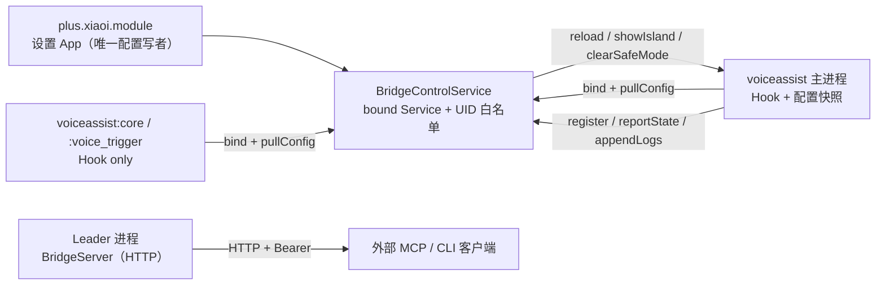

# 0.12.0 核心重构计划（已冻结）

> 状态：**计划冻结，等待开工**
> 基线：`0.11.0-beta.4`（versionCode 15）
> 目标：`0.12.0-beta.1` → `0.12.0`
> 日期：2026-11-06
> 详细工作包：[WORKPACKAGES.md](WORKPACKAGES.md)
> 被否决的草案：[drafts/](drafts/)（HMAC/Provider/配对码方案，仅作讨论记录）

## 1. 最终决策

| 编号 | 决策 | 理由 |
|---|---|---|
| D1 | 采用**核心重构**，不推倒 Hook / MCP 协议 | Hook 适配和协议层是已验证资产 |
| D2 | 目标 `0.12.0`，先发 `0.12.0-beta.1` | 留出真机回归窗口 |
| D3 | 包名、签名、旧配置升级兼容 | 不能让用户卸载重装 |
| D4 | 优先级：安全 > 可信状态 > 可用性 > 可维护性 | 先保证不泄密、不丢配置 |
| D5 | 威胁模型包含**本机普通应用** | loopback 对本机所有应用可见 |
| D6 | 控制面用 **bound Service + Binder**，不用 exported Provider | 显式组件不受包可见性限制，override 面更小 |
| D7 | 多进程用**端口绑定 leader 选举**，全机只一个数据面 | 不依赖主进程/ facade 在哪个进程 |
| D8 | `config.json` 移到 **App 私有目录**，秘密不再放 `Android/data` | 防 `MANAGE_EXTERNAL_STORAGE`/adb 读写 |
| D9 | 删除 HMAC `xiaoi-bridge/2`、`/hello`、`/auth/begin`、`/pair`、岛配对码 | 控制面已有内核 UID，HMAC 是过度设计 |
| D10 | 远程 MCP 只能改 `model`/`marker`/已有 provider 选择；禁止 `baseUrl`/`apiKey`/`bridge`/`lan` | 防止把 apiKey 导向攻击者端点 |
| D11 | `/config` 改为 `410 Gone`，不再接受 HTTP 写配置 | 单一写者，消除 apiKey 传输面 |
| D12 | LAN 必须 32 hex（128 bit）token；短 token 只允许 loopback | 防 LAN 爆破/嗅探 |
| D13 | 暂停只停数据面/热应用，**允许编辑服务商/模型/密钥** | 与“配置全部保留”一致 |
| D14 | `safe_mode` 只手动触发、只关数据面，控制面保留 | 避免自动熔断把 MCP 锁死 |
| D15 | 发布门禁：CI 跑一致性；tag 无正式签名不得建 Release | 防止临时密钥/未签名产物发布 |

## 2. 目标架构

### 2.1 三条通道



- **控制面**：App 的 `BridgeControlService`。只有 `com.miui.voiceassist` 的 UID 能 bind。
  每个小爱进程都可以 bind 拿配置；只有 leader 注册数据面并上报端口/状态。
- **数据面**：leader 进程内的 HTTP server，只服务外部 MCP/CLI/日志/统计。
  不做 App → HTTP 的配置推送，不做端口扫描。
- **配置**：App 私有 `config.json` 是唯一事实源。App 写，bridge 通过 Binder 拉。
  target prefs 只保留“降级兼容缓存”，不再作为主配置源。

### 2.2 控制面协议

App 侧 `BridgeControlService`（exported=false + 显式 ComponentName 仍可被系统外应用 bind；
必须在每个 Binder 方法首行做 UID 校验）：

```java
interface IBridgeControl {
    // 每个小爱进程启动/重连时调用；返回完整配置快照（含 apiKey/token）
    Bundle pullConfig();

    // 注册回调；leader 额外上报 port/instance；非 leader 只上报进程名
    void register(IBinder callback, Bundle instanceInfo);

    // 上报 appliedRev / 运行时 model / 错误
    void reportState(Bundle state);

    // 批量日志（有界、2s 节流）
    void appendLogs(String jsonLines);

    // 可选：0.11 升级时读取旧运行时配置
    Bundle legacySnapshot();
}
```

App → 小爱进程通过 `Messenger`/`IBinder` callback 下发：

- `reload`：配置 rev 变了，重新 `pullConfig`
- `showIsland`：弹一次岛（App 不再走 `/island`）
- `clearSafeMode`
- `flushLogs`

**UID 校验**：

- 每个 Binder 方法第一行 `Binder.getCallingUid()`。
- 允许集合 = `PackageManager.getPackageUid("com.miui.voiceassist", 0)` +
  `getPackagesForUid(uid)` 校验包名；不缓存授权结论，或缓存 ≤5s 且带包名。
- 其他 UID 一律 `SecurityException`。
- 服务不提供文件/Provider override，避免 confused deputy。

**为什么不用 Provider**：调用方包可见性、authority 抢占、`query/openFile/...`
override 面都不可控；Service 只有一个 Binder 方法面。
**为什么不用 HMAC**：控制面已有内核 UID；HMAC 只增加离线验证器和协议复杂度。

### 2.3 数据面

- leader 进程尝试 `bind 127.0.0.1:8771~8775`（LAN 时 `0.0.0.0`）。
- 第一个绑定成功的进程成为 leader；其他进程只 hook。
- leader 退出/被杀 → 端口释放 → 其他进程在 30s 内重试接管。
- leader 通过控制面上报实际端口；App 显示该端口，不再扫描。
- `/config` 返回 `410 Gone`，不解析 body；旧客户端得到可行动错误。
- `/island` 保留 loopback-only 兼容；App 自身走控制面。
- `/health` 只接受 Bearer，不再作为“可伪造的身份依据”。
- `/mcp`、`/cli`、`/logs`、`/stats` 仍用 Bearer；LAN 需 128-bit token。
- 有界队列、最大连接数、header 上限、全端点限流。

### 2.4 配置与迁移

**唯一事实源**：`getFilesDir()/config.json`（私有），schema `version=3`，新增 `rev`。

- App 是唯一写者：原子写（tmp + fsync + rename），不先删除目标。
- 每次保存 `rev = max(file.rev, revFloor) + 1`；`revFloor` 只用于 App 写入。
- 解析失败：保留原文件，复制 `config.json.corrupt.<ts>`，进入只读态并提示；
  绝不静默回默认。
- 备份 `config.json.bak` 与完整导出文件都含密钥，导出后提示删除。
- 秘密不再写 `Android/data`；需要 adb 调试时用 App 内“导出脱敏/完整备份”。
- target prefs 只写 legacy 兼容键（base/model/key/token），并带 `cfgRev`；
  bridge 读取时以控制面为准，target 只做降级兜底。
- **首启/升级**：如果私有 config.json 不存在，App 通过 `legacySnapshot()` 读取
  0.11 的 target/module prefs；展示“发现旧配置，采用/放弃”，用户确认后才写文件。
  默认骨架必须带 `isSkeleton=true`，bridge 拒绝用骨架覆盖非骨架缓存。

**MCP-only**：配置读取不再要求 baseUrl/model 非空；token/lan/bridge 与模型独立。

### 2.5 状态模型

四个维度，互不伪造：

| 维度 | 数据来源 | UI |
|---|---|---|
| D1 配置有效 | App `ConfigCodec.validate` | 配置页状态条 |
| D2 端点可达 | `ModelValidator` 显式/自动校验 | “端点可用 · 320ms” |
| D3 已应用 | bridge `appliedRev == config.rev` | “已推送/等待小爱应用” |
| D4 运行时在用 | bridge 上报 `enabled/model/hasKey` | 只有这里能显示“已确认” |

- `ModelValidator` 成功只改 D2，绝不改 D4。
- 保存只依赖文件写入成功；桥不在线显示“已保存，等待小爱应用”。
- 暂停允许编辑；暂停只影响 D3/D4 的数据面。
- 日志/运行状态走控制面，不再要求 MCP 开启。

## 3. 工作包与顺序

| WP | 名称 | 依赖 | 规模 |
|---|---|---|---|
| WP1 | 控制面 Service + UID + pull/register/report | 无 | L |
| WP2 | 配置单一事实源 + 私有文件 + rev + 迁移 | WP1 接口 | L |
| WP3 | 生命周期 + leader 选举 + 关闭即停 | WP1 | M |
| WP4 | 数据面加固 + `/config` 410 + MCP 写权限 | WP3 | M |
| WP5 | ConfigActivity 机械拆分（无行为变化） | 无 | M |
| WP6 | 状态模型 + 主页/配置页/日志页 | WP1/WP2/WP5 | L |
| WP7 | UX 安全 + 错误目录 + 导入/导出 | WP6 | M |
| WP8 | 发布门禁 + 测试 + 真机矩阵 + beta | 全部 | M |

详细范围、验收标准、涉及文件、子 Agent 指令见 [WORKPACKAGES.md](WORKPACKAGES.md)。

## 4. 迁移与回滚

- `0.11.0-beta.4 → 0.12.0-beta.1`：首次启动先读旧配置，用户确认后写私有文件；
  不丢 baseUrl/model/key/token。
- `config.json` v2 → v3：`rev=1`，保留未知字段；旧 `mcp.lan` 映射到新字段；
  旧 token 原样保留，但 LAN 只接受 32 hex，短 token 首次开 LAN 时强制轮换。
- 降级到 0.11：配置可读（v3 保留 version），但 0.11 的 `bridge` 硬编码 true，
  **会重新开启 MCP**；Release Notes 必须显著警告，并建议降级前关闭 MCP/清空 token。
- 回滚点：每个 WP 独立 commit；WP 失败可回退，不回滚用户配置。
- 发布门禁：CI 跑单测 + 一致性；tag 无正式签名 → 失败，不建 Release；
  `scripts/verify-apk.sh` 校验签名指纹。

## 5. 安全评审结论（已采纳）

**采纳**
- 控制面改 bound Service；Provider 不作为主路径。
- 删除 HMAC、`/hello`、`/auth/begin`、`/pair`、岛配对码。
- 远程 MCP 禁止 `baseUrl`/`apiKey`/`bridge`/`lan`。
- `config.json` 移私有目录；秘密不进 `Android/data`。
- LAN 强制 128-bit token；`/config` 410。
- 端口绑定 leader 选举；关闭即停。
- 发布门禁硬校验签名。

**不采纳/延后**
- exported Provider 主路径（包可见性/override 面/authority 抢占不可控）
- HMAC 会话协议（过度设计，控制面已解决身份）
- 自动 `safe_mode` 熔断（退出通道不明确）
- 与安全重构绑定的 `ConfigActivity` 大拆分（先机械拆分，后改行为）

## 6. 完成定义

- 代码中不存在“向未认领端口发送 Bearer”的路径。
- MCP 关闭后 `ss -ltn` 无 8771~8775；重启小爱仍关闭。
- 首次配置不需要无鉴权 `/config`；旧配置升级不丢。
- 本机第三方 App / `adb shell` 调用控制面被拒绝；voiceassist 成功。
- 远程 MCP 带 `baseUrl`/`apiKey`/`bridge`/`lan` 被拒绝。
- 状态四维分离；校验模型不再伪造“已确认”。
- 暂停可编辑服务商/模型/密钥。
- 从 beta.4 覆盖安装成功，配置/Token 保留。
- CI 单测 + 一致性全绿；真机 P0 矩阵通过；签名指纹与 beta.4 一致。
