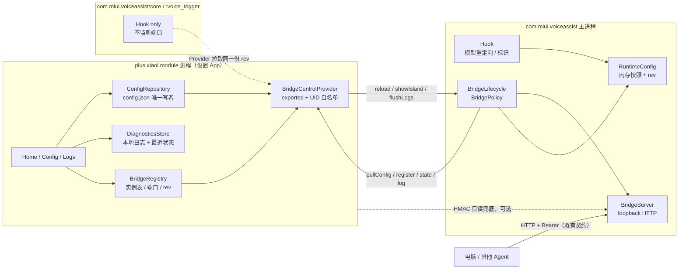
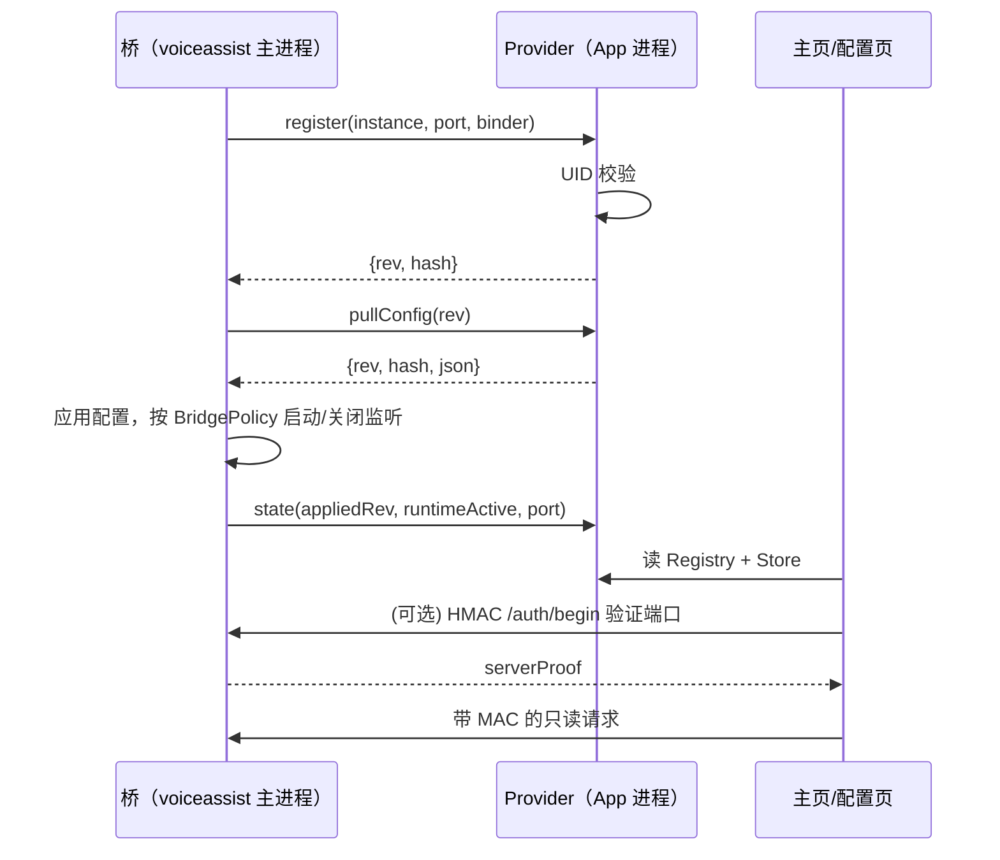

# 目标架构：控制面 / 数据面 / 单一事实源

> 状态：**规划中，未实现**。本文只描述 0.12.0 的目标设计，不代表仓库现状。
> 基线：`0.11.0-beta.4`（versionCode 15）。
> 前置阅读：[README.md](README.md)。

## 0. 一句话结论

把「App 通过 loopback HTTP 向 8771~8775 广播 Token 并推送整份配置」改成：

- **控制面**：App 暴露一个 **UID 白名单校验的 Provider**，小爱进程（`com.miui.voiceassist`）
  通过 Binder 拉取配置、回注册实例、回传状态与日志；App 通过回注册的 `Messenger`
  下发少量命令（重载、弹岛、flush 日志）。
- **数据面**：loopback HTTP 只服务 **外部 MCP 客户端**（Bearer）与 App 的**只读兜底**
  （HMAC 挑战-响应，永不发送 Token）。
- **单一事实源**：`config.json`（带 `rev`）由 App 进程唯一写入；模块 prefs 与
  小爱 target prefs 都降级为**缓存**，必须带 `cfgRev`，不得反向覆盖文件。

这样同时消掉审计里的 1/2/3/4/5/6/7/8 八类问题，而不是逐个打补丁。

---

## 1. 审计结论 → 设计响应

| # | 现状问题 | 目标设计中的正面响应 | 验收锚点 |
|---|---|---|---|
| 1 | 发现/推送把 Bearer 发给每个端口；假端口可拿 Token 和 `/config` | App 不再向任何端口发 Token；端口身份用 HMAC 证明；配置改走 Provider，HTTP 不再承载 apiKey | 代码中不存在「未认领端口 + Authorization」路径 |
| 2 | `Hook` 无条件 `install`，`install` 无条件 `startServer`；关闭只影响 LAN | 生命周期由纯 JVM 策略 `BridgePolicy` 决定；`mcp.enabled=false` 直接 `close()` 监听 | `ss -ltn` 无 8771~8775；重启小爱仍无监听 |
| 3 | `Config.forTarget()` 把 `marker/bridge` 硬编码为 true | target prefs 改为带 `cfgRev/cfgHash` 的缓存；缺字段不再猜默认值 | 关闭 MCP 后重启小爱仍关闭 |
| 4 | 首次保存假失败（401 → 「令牌与桥不一致」） | 保存只依赖文件写入；应用状态由 `appliedRev` 单独表达 | 桥不在线时保存仍成功，UI 显示「等待小爱应用」 |
| 5 | 模型校验成功把 `runtimeActive` 置 true | 四维状态模型；只有桥能写「运行时在用」 | 校验只改「端点可达」，不改「小爱运行时」 |
| 6 | 日志/确认被 MCP 绑架；暂停禁编辑；LAN 只改草稿；导入无确认；损坏静默回默认；发布门禁缺失 | 日志走控制面；暂停不锁编辑；脏状态显式；导入二次确认；损坏进只读态；CI/release 加固 | 见 WP4~WP7 验收 |
| 7 | 多进程各起桥，三份状态互相覆盖 | 主进程单桥 + 其他进程只 hook；注册表按进程登记 | 全机只有一个 877x 监听 |
| 8 | MIUI 把 App prefs 重定向，XSharedPreferences 读不到 | 不再依赖跨进程 prefs；Provider + 自写 target 缓存 | 重定向设备上首次配置可闭环 |
| 9 | Java 8 / 无 Gradle / 无第三方依赖 / 手写 View | 所有新协议与状态机保持纯 JVM；不引入任何依赖 | `tests/run.sh` 能编译即证明无 Android 依赖 |

---

## 2. 目标架构

### 2.1 进程与通道



### 2.2 模块边界

新增代码按职责分包；既有 `Hook` 暂不移动，避免一次 diff 过大。

| 包 | 职责 | 是否允许 Android API | 代表类（计划） |
|---|---|---|---|
| `plus.xiaoi.module.core` | 协议、编解码、状态机、策略 | 否（纯 JVM） | `BridgeProtocol`、`BridgeSession`、`ConfigCodec`、`StateModel`、`BridgePolicy` |
| `plus.xiaoi.module.control` | Provider、UID 校验、注册表 | 是 | `BridgeControlProvider`、`UidGuard`、`BridgeRegistry`、`InstanceRecord` |
| `plus.xiaoi.module.bridge` | socket、生命周期、Mcp.Host 接线 | 是 | `BridgeServer`、`BridgeLifecycle`、`BridgeHost`、`LogSink` |
| `plus.xiaoi.module.hook` | 既有 Hook 与配置消费 | 是 | `Hook`（保持原位，改为读 `RuntimeConfig`） |
| `plus.xiaoi.module.ui` | Activity / 页面 section | 是 | `HomeActivity`、`ConfigActivity` 拆分后的 section |

**为什么**：纯 JVM 层可以直接被 `tests/run.sh` 编译，协议和状态机不依赖真机；Android 层只做接线。
**放弃的替代方案**：继续把逻辑堆在 `Bridge`/`ConfigActivity` 里。理由是无法单测、无法做安全评审的边界证明。

### 2.3 控制面与数据面职责

| 能力 | 控制面（Provider/Binder） | 数据面（HTTP） |
|---|---|---|
| 拉取配置（含 apiKey/token） | ✅ 唯一入口 | ❌ 禁止 |
| 上报 `appliedRev` / 运行时模型 | ✅ | ❌ |
| 上报日志 | ✅ 批量 | 仅外部客户端 `/logs` 只读 |
| 触发弹岛 | ✅ `Messenger` | `/island`（保留，兼容） |
| 外部 MCP `tools/call` | ❌ | ✅ Bearer |
| 外部 `/cli` | ❌ | ✅ Bearer |
| 端口发现 | 注册表（UID 证明） | `/hello`（无秘密） |
| 令牌轮换 | 写 config.json + notify | 立即 401 旧会话 |

**为什么**：把「谁能写配置」和「谁能调能力」分开。控制面有内核提供的 UID 证明，不需要在网络上传输长期秘密；数据面服务的是用户显式配置过的外部客户端，继续用 Bearer 是合理的。
**放弃的替代方案**：只做 HMAC 不做 Provider。那样 App 仍需扫描端口，且日志/状态在 MCP 关闭时无法读取；HMAC 只能解决「不泄露 Token」，解决不了「单一事实源」和「多进程」。

---

## 3. 桥的信任模型

### 3.1 信任边界

| 主体 | 信任级别 | 能做什么 | 不能做什么 |
|---|---|---|---|
| App 进程（`plus.xiaoi.module`） | 高（持有 config.json） | 写配置、读桥状态、下发命令 | 不能伪造 voiceassist UID |
| 小爱主进程（被注入） | 高（内核 UID = voiceassist） | 拉配置、注册实例、执行 MCP | 不能读 App 私有文件 |
| 手机上的其他普通应用 | **不可信** | 可占端口、可发任意 HTTP、可调用 exported 组件 | 不能通过 UID 校验、不能伪造 HMAC |
| 局域网设备 | 不可信 | 可连 0.0.0.0 端口 | 无 Token 一律 401 |
| root / 物理接触 | 不在威胁模型内 | 全部 | — |

关键事实：**Android loopback 不向服务端提供对端 UID**。因此不能靠 `s.getInetAddress()` 判断调用者；
必须用「持有秘密」或「内核 Binder UID」二选一。

### 3.2 凭据分层

| 名称 | 长度 | 生命周期 | 存放 | 用途 |
|---|---|---|---|---|
| `bridgeToken` | ≥128 bit（App 生成 32 hex） | 用户轮换 | `config.json` 的 `mcp.token`；桥内存 | HMAC 的 IKM；外部客户端 Bearer |
| `instanceId` | 128 bit 随机 | **每次进程启动重新生成** | 桥内存；注册表 | 标识一次桥进程，天然让陈旧注册失效 |
| `clientNonce` / `serverNonce` | 256 bit 随机 | 单次握手 | 不落盘 | 抗重放、派生会话密钥 |
| `sid` | 128 bit | 600 s | 桥内存会话表 | 定位会话 |
| `K_id` / `K_mac` | 256 bit | 单次会话 | 双方内存 | 服务端证明 / 请求 MAC |

**为什么 instanceId 不持久化**：持久化会让「桥死了、端口被恶意应用占用」继续匹配旧注册。
每次启动换新值，旧注册必然失配，App 会重新握手；代价只是 App 重启后多一次注册。

### 3.3 HMAC 挑战-响应协议 `xiaoi-bridge/2`

#### 3.3.1 端点

| 方法 | 路径 | 鉴权 | 响应含秘密 | 说明 |
|---|---|---|---|---|
| GET | `/hello` | 无 | 否 | 仅用于短名单：`proto/port/instance/startedAt`，**永不作为身份依据** |
| POST | `/auth/begin` | 客户端 HMAC 证明 | 服务端证明 | 建立会话 |
| 任意 | 业务端点 | `X-Xiaoi-*` 请求 MAC 或 Bearer | 按端点 | 见 3.4 |

`/hello` 存在的原因：App 在注册表为空时需要一个无秘密的方式判断「这个端口像不像我们的桥」。
它返回的任何字段都可被伪造，因此**只用于减少握手次数，不用于授权**。

#### 3.3.2 `POST /auth/begin`

编码约定（全协议统一）：

- `tokenBytes` = `token.trim()` 的 UTF-8 字节；保存时已去掉首尾空白。
- `base64url` = RFC 4648 §5，**不带 `=` padding**。
- 十六进制小写；整数为十进制 ASCII，无前导零。
- 所有 HMAC 输出 32 字节；比较前先校验长度，再用 `MessageDigest.isEqual`。

请求：

```json
{
  "v": 2,
  "port": 8773,
  "clientNonce": "base64url(32B)",
  "clientTs": 1762400000000,
  "proof": "base64url(HMAC-SHA256(token, C0))"
}
```

其中：

```text
C0 = ASCII("C0\n") || port || "\n" || clientTs || "\n" || base64url(clientNonce)
```

服务端校验（顺序固定，任一失败即 401，不泄漏失败原因）：

1. `port` 必须等于本进程实际监听端口（防跨端口重放、防代理改写）。
2. `clientTs` 与本地时间差 ≤ 120000 ms。
3. `clientNonce` 解码后必须 32 字节。
4. `proof` 与本地计算值用 `MessageDigest.isEqual` 比较（定长 32 字节，常数时间）。
5. 握手限流：每端口 20 次/分钟、200 次/小时；超限 429 + `Retry-After`。

通过后生成 `serverNonce`(32B)、`serverTs`、`sid`(16B)，并计算：

```text
TH = SHA-256(
  "xiaoi-bridge/2\n" ||
  "port=" || port || "\n" ||
  "instance=" || instanceIdHex || "\n" ||
  "clientNonce=" || base64url(clientNonce) || "\n" ||
  "serverNonce=" || base64url(serverNonce) || "\n" ||
  "clientTs=" || clientTs || "\n" ||
  "serverTs=" || serverTs || "\n"
)

prk   = HKDF-Extract(salt = clientNonce || serverNonce, ikm = tokenBytes)   // = HMAC-SHA256(salt, ikm)
K_id  = HKDF-Expand(prk, info = "xiaoi-id-v2"  || TH, L = 32)
K_mac = HKDF-Expand(prk, info = "xiaoi-req-v2" || TH || sid, L = 32)

serverProof = HMAC-SHA256(K_id, ASCII("S2C") || TH)
```

响应：

```json
{
  "v": 2,
  "port": 8773,
  "instance": "hex(16B)",
  "serverNonce": "base64url(32B)",
  "serverTs": 1762400000123,
  "sid": "base64url(16B)",
  "proof": "base64url(32B)",
  "expiresIn": 600
}
```

客户端校验：`port == 实际连接端口`；`instance` 若注册表有提示则必须相等；`serverTs` 在 ±120 s；
`proof` 常数时间比较。失败即丢弃该端口，**不发送任何后续请求**。

**为什么把 port/instance/两个 nonce/两个 ts 全放进 TH**：任何一个字段被替换都会让
`serverProof` 失效；因此占用 8771 并把它代理到 8772 的透明中继无法通过——桥会返回
`port=8772`，而 TH 里的 port 也是 8772，中继改不了 proof。

#### 3.3.3 业务请求 MAC

每个请求头：

```text
X-Xiaoi-Sid:   base64url(sid)
X-Xiaoi-Ts:    1762400000456
X-Xiaoi-Nonce: base64url(16B 随机)
X-Xiaoi-Mac:   base64url(HMAC-SHA256(K_mac, M))
```

```text
M = ASCII(method) || "\n" ||
    ASCII(pathWithQuery) || "\n" ||
    ts || "\n" ||
    base64url(nonce) || "\n" ||
    hex(SHA-256(body))
```

服务端校验：

1. `sid` 存在、未过期（绝对 600 s，空闲 120 s 回收）、实例匹配。
2. `ts` 在 ±120 s。
3. `nonce` 未在该会话出现过（每会话 LRU 256 条）。
4. `Mac` 常数时间比较。
5. 同一 `sid` 连续 5 次失败 → 立即销毁会话；全局不再做熔断，避免本机应用故意把 App 锁死。

失败统一 `401 {"ok":false,"error":"unauthorized"}`，不区分「sid 不存在 / MAC 错 / 过期」。
请求体上限沿用 `Http.MAX_BODY`；MAC 校验在解析业务 JSON **之前**完成。

#### 3.3.4 为什么不再「先发 Token 再验证」

旧流程：`GET /health` 带 `Authorization: Bearer <token>` → 谁监听端口谁就能记录 Token。
新流程：

- `/hello` 不含任何凭据；
- `/auth/begin` 只发送 `HMAC(token, 已知串)`，Token 本身永不出现在字节流里；
- 只有证明过服务端持有 Token 的端口，才会收到后续请求；
- 后续请求用派生密钥 `K_mac`，不重复使用 Token。

**残余风险（必须写进安全评审）**：任何挑战-响应都会给攻击者一个「离线口令验证器」
（`HMAC(token, 已知串)`）。对策是强制 Token 为 App 生成的 128 bit 随机值，并在保存时拒绝
短于 32 hex 的新 Token；旧弱 Token 只警告不阻断。PAKE（SPAKE2/OPAQUE）可以从根本上消除，
但需要额外密码学实现与依赖，不符合「无第三方依赖」约束，**明确放弃**。

### 3.4 Bearer 与 HMAC 的关系

| 场景 | 使用 | 原因 |
|---|---|---|
| App → 桥（控制面） | Provider UID | 不经过网络，内核证明调用者 |
| App → 桥（HTTP 兜底） | HMAC | 不泄露 Token，能抗端口冒名 |
| 外部 MCP 客户端 → 桥 | Bearer | 客户端由用户显式配置，无法实现自定义握手 |
| 局域网 → 桥 | Bearer + 显式开关 | 既有契约；LAN 仍是明文 HTTP，属已知限制 |

桥对同一端点接受两种鉴权：先看 `X-Xiaoi-Sid`，没有再看 `Authorization`。**不接受**
「两种都没有」；`mcp.enabled=false` 时端口都不存在。

### 3.5 与 0.11 客户端 / 旧契约的兼容

| 组合 | 行为 |
|---|---|
| 0.12 App + 0.12 桥 | 新协议 |
| 0.12 App + 0.11 桥（升级后未重启小爱） | 注册表为空、`/hello` 无 `proto=2` → UI 显示「桥版本过旧，请重启小爱」；**不回退发 Bearer** |
| 0.11 App + 0.12 桥 | `/health` Bearer 仍 200；`/config` 返回 `410 Gone`；旧 App 会显示推送失败——这是预期的降级提示 |
| 旧 MCP 客户端 | `/mcp`、`initialize`、`tools/list`、`tools/call`、`2025-03-26` 全部不变 |
| 旧 `config.json` | 迁移到 v3，见 migration.md |
| 旧 Token | 原样可用；不强制轮换 |

`/health` 的响应体保持精确的 `ok facade=<bool> port=<int>`，以保住 `tests/baseline/health.body`
与真机契约脚本的既有判据；新字段只出现在 `/hello`。**为什么**：契约基线是回归资产，
不应为了「多返回几个字段」而制造无意义 diff。**放弃的方案**：把 `/health` 改成 JSON。

---

## 4. 端口发现与配置投递

### 4.1 注册表（首选路径）

桥在主进程启动后：

```text
call("register", {instanceId, pid, processName, port, proto=2, boundLan, startedAt, callbackBinder})
```

> 注册与控制面生命周期**不受 `mcp.enabled` 影响**：MCP 关闭时 `port=0`、`boundLan=false`，
> 但实例仍注册，App 仍能读状态、看日志、发重载/弹岛命令。否则「关闭 MCP」会让整个
> 模块从 UI 消失，用户无法再打开它。

Provider 侧：

1. `Binder.getCallingUid() == PackageManager.getPackageUid("com.miui.voiceassist", 0)`；
2. 校验 `port ∈ 8771..8775`、`proto == 2`、`instanceId` 32 hex；
3. 写入内存 `BridgeRegistry`，并持久化「提示」（port/instance/lastSeen，不含 token）；
4. 返回当前 `rev/hash`，桥立即 `pullConfig`。

App 侧拿到的实例记录：

```text
{instanceId, pid, process="com.miui.voiceassist", port, boundLan, startedAt, lastSeen,
 appliedRev, runtimeModel, runtimeActive, facadeReady, cliReady, lastError}
```

**为什么注册表可信**：只有运行在 voiceassist UID 下的代码才能通过 UID 校验；
普通应用即使调用 Provider 也只能拿到 `SecurityException`。这比 HMAC 更强，因为它不依赖网络。

**注册表只作为提示**：App 在真正发请求前仍会做一次 HMAC 握手。原因：
桥可能已崩溃、端口可能被别的应用复用；注册表是内存/持久化提示，不是实时真相。

### 4.2 发现流程



1. 优先读注册表；有实例则直接对 `port` 做 HMAC 握手（只读端点）。
2. 注册表为空：对 `8771..8775` 并发 `GET /hello`（连接 300 ms / 读 500 ms），
   只保留 `proto=2 且 port==探测端口` 的候选。
3. 对候选逐个 `/auth/begin`；全部失败则结论为「小爱未运行或桥未启用」。
4. 不做「全端口广播 Bearer」，也不做「全端口 `/config`」。

### 4.3 配置投递

**不再有 HTTP 配置推送。** 三条路径：

1. **桥启动**：`pullConfig` 拉整份 JSON（含 rev/hash）。
2. **App 保存**：`ConfigRepository` 写文件 → `ContentResolver.notifyChange(uri)`；
   桥注册的 `ContentObserver` 收到后 `pullConfig`。
3. **兜底轮询**：桥每 60 s 比较一次 `rev`（Provider 调用很轻），防止 ROM 丢通知。

`config.json` 变更到生效的目标时间：≤ 2 s（通知路径），≤ 60 s（轮询兜底）。

实现细节（WP3 必须落实）：

- Provider authority 固定为 `plus.xiaoi.module.control`，配置 URI 为
  `content://plus.xiaoi.module.control/config`；App 写文件后调用
  `ContentResolver.notifyChange(uri)`，桥用 `registerContentObserver(uri, true, ...)` 订阅。
- 观察者只能拿到「变了」这个事实，拿不到内容；内容一律重新 `pullConfig`，避免把
  apiKey 塞进通知。
- App 进程重启后 observer 仍有效（观察者注册在桥进程，Provider 在 App 进程；URI 不变）；
  桥的 Binder 回调会失效，因此桥每 15 s 重注册一次，收到 `DEAD_OBJECT` 立即重试。
- 若 `registerContentObserver` 抛异常或 60 s 内没有收到任何通知，桥按轮询模式工作，
  并在状态里标记 `sync=observer|poll`。

**为什么删除推送**：

- 推送把「保存成功」和「桥在线」耦合，制造了假失败；
- 推送需要把 apiKey 放进 HTTP body，是本次审计的核心泄露面；
- 推送的「多 token 回退」是轮换死锁的补丁，根源是状态分裂；
- 推送无法解决多进程覆盖。

**放弃的替代方案**：保留 `/config` 但加 HMAC。这样仍需要 App 知道端口、仍要处理
「桥不在线」的保存语义，收益低；直接删除更干净。`/config` 在 0.12 返回 `410`，
并提示改用 App 或 MCP `xiaoai_switch_model`。

### 4.4 端口被占 / 冒名 / 陈旧注册

| 情况 | 检测 | 行为 |
|---|---|---|
| 8771 被其他应用占用 | `bind` 失败 | 依次 8772~8775；注册表记录实际端口 |
| 冒名服务响应 `/hello` | 返回内容像但不含 `proto=2`，或端口不符 | 丢弃 |
| 冒名服务伪造 `/hello` | 能伪造 | 进入 HMAC；无 token 无法通过 `/auth/begin` |
| 桥崩溃、端口被复用 | 注册表 instance 与握手响应不符 | 删注册项，不发送任何数据 |
| 无可用端口 | 8771~8775 全部 bind 失败 | 不启动数据面；控制面上报 `port=0` 与错误 |
| 多个进程都尝试监听 | 只有主进程允许 `startServer` | 其他进程只 hook + 注册 hook 状态 |

---

## 5. 首次配置 bootstrap

### 5.1 为什么需要 bootstrap

桥进程需要 `token` 才能开数据面；但 token 的事实源在 App 的 `config.json`。
正常路径由 Provider 解决；bootstrap 只处理 **Provider 不可用**（App 被 force-stop、
MIUI 后台限制、Provider 崩溃）。

### 5.2 方案比较

| 方案 | 安全性 | 易用性 | 无 root | 依赖 | 结论 |
|---|---|---|---|---|---|
| **P1 Provider UID 交接** | 高：内核 UID，无网络 | 高：无感 | ✅ | Provider 可用 | **推荐主路径** |
| **P2 超级岛配对码 + `/pair`** | 中高：6 位一次性码 + 5 分钟过期 + 3 次/5 分钟；用户需看到岛 | 中：多一步抄码 | ✅ | 岛可用 | **兜底路径** |
| P3 空 token 时开放 `/config` | 低：本机任意应用可抢占 | 高 | ✅ | — | **拒绝**（现状漏洞） |
| P4 ADB-only 注入 | 高：shell UID，显式 | 低：需要电脑 | ✅ | adb | 仅开发者恢复 |
| P5 root 直写 target prefs | 高（root 已在模型外） | 高 | ❌ | root | 可选加速 |
| P6 无确认 TOFU | 低：先占先得 | 高 | ✅ | — | **拒绝** |

### 5.3 推荐组合

```text
启动
 ├─ 有 token（target 缓存） → 直接按策略启动
 ├─ 无 token → 尝试 Provider.pullConfig
 │    ├─ 成功 → 写入 token/配置 → 启动
 │    └─ 失败 → 进入 UNPAIRED
 │         ├─ 能显示超级岛 → 生成 6 位码，开 /pair（仅 loopback、5 分钟、一次性）
 │         │     └─ App 收到用户输入 → POST /pair {code, token} → 桥校验 → 启动
 │         └─ 不能显示 → 关闭数据面，仅日志；UI 提示「打开 App 完成配对 / 用 ADB」
 └─ 数据面永不因「无 token」而开放
```

`/pair` 的约束（写死在测试里）：

- 只接受 loopback；
- `code` 6 位数字，`SecureRandom` 生成，常数时间比较；
- 失败 3 次或 5 分钟过期即销毁，不自动续期；
- 成功后立刻清除 code，写 target 缓存，**不再接受 `/pair` 直到下次 UNPAIRED**；
- 请求体只允许 `{code, token}`，token 长度 32~128，写失败返回 503。

**为什么 P1 优先**：它同时解决 bootstrap、配置下发、日志回传、多进程一致性问题，
且不增加网络攻击面。**为什么 P2 仍保留**：MIUI 对后台启动第三方 Provider 有限制，
必须有用户可完成的降级路径；岛是模块已经验证过的 UI 通道。
**放弃 P3**：它正是审计第 2 条的漏洞；任何「先到先得」的窗口都会被本机应用抢占。

### 5.4 bootstrap 状态机

| 状态 | 进入条件 | 允许的操作 | 退出 |
|---|---|---|---|
| `UNPAIRED` | 无 token 且 Provider 失败 | 显示岛配对码 / 提示打开 App | 配对成功 / 用户关闭 MCP |
| `PAIRING` | 已显示码 | 接受 `/pair` | 成功 → `PAIRED`；超时/失败 → `UNPAIRED` |
| `PAIRED` | 有 token | 正常启动 | 用户轮换/清空 token → `UNPAIRED` |
| `BLOCKED` | 无 token 且无法显示岛 | 仅日志 | 用户打开 App / ADB 注入 |

---

## 6. MCP 关闭语义

### 6.1 关闭后必须停止什么

`mcp.enabled=false`（保存并应用后）：

| 能力 | 状态 |
|---|---|
| `ServerSocket` 8771~8775 | **全部 close**，`sStarted=false`，`sPort=0` |
| `GET /hello`、`/health`、`/mcp`、`/cli`、`/logs`、`/stats`、`/island` | 不可达（connection refused） |
| 现有 HMAC 会话 / Bearer 校验 | 全部失效（内存表清空） |
| 注册表数据面实例 | `unregister`，端口置 0 |
| 模型重定向 Hook | **继续运行**（与 MCP 无关） |
| 控制面 Provider | 继续运行（不是网络端口） |
| 日志回传 | 继续（经 Provider） |
| 局域网绑定 | 随监听一起消失 |

> 首页「显示超级岛」在 0.12 改走控制面 `Messenger`，因此 MCP 关闭仍可用；
> HTTP `POST /island` 只作为外部/兼容入口保留，不再被 App 依赖。

### 6.2 生命周期策略（纯 JVM）

```text
shouldListen =
    versionSupported
 && !safeMode
 && mcp.enabled
 && token.length >= 16
 && (!mcp.lan || lanAllowed)

bindHost = mcp.lan ? "0.0.0.0" : "127.0.0.1"
```

事件：

| 事件 | 动作 |
|---|---|
| 配置 rev 变化且 `shouldListen=true`、未监听 | `startServer` |
| 配置 rev 变化且 `shouldListen=false`、已监听 | `closeServer` + 清会话 + unregister |
| `bindHost` 变化 | 原地 close → 用原端口优先重绑（失败再扫） |
| 主进程死亡 | 注册表 `lastSeen` 过期；App 显示「小爱未运行」 |
| 重启小爱 | 从 Provider/缓存重新读 rev；`shouldListen` 为 false 就不启动 |

**为什么把策略抽成纯 JVM**：`startServer` 现在被 `install` 无条件调用，任何 flag 组合都能
起监听；策略函数可以穷举测试所有组合（8 个输入 → 预期结果）。

> **重要边界**：`shouldListen=false` 不等于「模块不加载」。`RuntimeConfig`、Provider 注册、
> Hook、日志回传仍然运行；被关闭的只是 `ServerSocket`。否则「关闭 MCP」会连带停止模型
> 重定向，违背产品承诺。主进程的入口是 `Hook.handleLoadPackage → RuntimeConfig.start()`
> （无论 MCP 开关），`BridgeLifecycle` 只负责监听那一半。

### 6.3 重启后如何保持关闭

旧的根因是 `Config.forTarget()` 在 target prefs 路径把 `bridge` 硬编码为 `true`。
新设计：

- target 缓存里写入完整的 `mcp.enabled/lan/token/cfgRev`；
- 读取时 `missing != true`；缺字段视为「未配置」，不是「开启」；
- 缓存带 `cfgRev`，Provider 可用时以 Provider 为准；
- 缓存损坏 → 不启动数据面（fail closed），日志提示。

---

## 7. 多进程方案

| 方案 | 描述 | 优点 | 缺点 | 结论 |
|---|---|---|---|---|
| A | 每个进程一个桥、各自监听 | 每个进程都有 facade/CLI | 多端口、多会话、多份 token、日志重复、注册表复杂 | 放弃 |
| B | **主进程单桥 + 其他进程只 hook** | 一个端口、一个会话表、一个注册项；状态可解释 | 主进程未加载时无 MCP | **推荐** |
| C | 新建独立进程承载桥 | 隔离好 | 需要改目标 App 的 manifest/进程模型，不可行 | 放弃 |

**为什么 B 可行**：MCP 的 `agent.submit` 通过 `bindService` 调 CLI 服务；主进程完全能拿到
binder。`Island`、`Logs`、`Usage` 都是进程无关或文件共享的。其他进程只需要 Hook
（模型重定向可能发生在任意进程），不需要监听端口。

实现约束：

- `Hook.handleLoadPackage` 用 `lp.processName` 判断：只有 `com.miui.voiceassist`（无冒号）
  调 `BridgeLifecycle.start`；其他进程只 `Hook.install` + `RuntimeConfig` 拉取。
- 其他进程仍注册「hook 状态」到 Provider（`registerHookOnly`），用于 UI 显示
  「:core 已加载 / :voice_trigger 未加载」；不产生端口。
- 若主进程在 15 s 内没有注册，`BridgeRegistry` 标记 `dataPlane=none`；不做跨进程选举，
  避免出现两个监听。

**放弃 A 的理由**：审计第 7 条的三份状态互相覆盖正是 A 的直接后果；A 还会让
`/health` 的「第一个端口」语义永久不确定。**放弃 C 的理由**：不能修改小爱 manifest。

---

## 8. 配置单一事实源

### 8.1 职责表

| 存储 | 位置 | 写者 | 读者 | 是否事实源 | 内容 |
|---|---|---|---|---|---|
| `config.json` | `Android/data/plus.xiaoi.module/files/` | **仅 App 进程** | App、Provider 调用方 | ✅ | 全部配置 + `rev/hash/updatedAt` |
| 模块 prefs | App 私有 `xiaoi_plus.xml` | App | App UI | ❌ | 主题、探针缓存、诊断游标、**legacy 镜像**（为降级） |
| target prefs | voiceassist 私有 `xiaoi_plus.xml` | 桥进程 | 桥进程 | ❌（缓存） | 最近一次 `configJson` + `cfgRev/cfgHash` + legacy key |
| `config.json.bak` | 同目录 | App | App | 恢复用 | 上一个成功版本 |
| `DiagnosticsStore` | App 私有 | App（桥推送） | 日志页 | ❌ | 桥日志、最近状态 |

**为什么保留 target prefs**：桥在 Provider 不可用、App 被杀、刚升级未重启时必须有一个
本地快照才能继续重定向；它是缓存，不是真相。**为什么保留 legacy key**：降级回 0.11 时
旧代码仍能读；0.13 再删。

### 8.2 schema v3

```json
{
  "version": 3,
  "rev": 7,
  "updatedAt": 1762400000000,
  "enabled": true,
  "marker": true,
  "markerTemplate": "",
  "activeProviderId": "deepseek",
  "activeModelId": "deepseek-chat",
  "mcp": {
    "enabled": true,
    "lan": false,
    "token": "32hex",
    "tokenSetAt": 1762390000000
  },
  "providers": [
    {
      "id": "deepseek",
      "name": "DeepSeek",
      "baseUrl": "https://api.deepseek.com/v1",
      "apiKey": "sk-...",
      "models": [{"id": "deepseek-chat", "name": "DeepSeek Chat"}]
    }
  ]
}
```

规则：

- `rev` 单调递增；每次成功写入 +1；不接受外部文件把 `rev` 改小（见 8.5）。
- `updatedAt` 为写入时刻；只用于展示与排障，不参与并发控制。
- 未知字段在顶层、`mcp`、provider、model 四层都原样保留（当前实现只保留顶层）。
- 序列化顺序固定；`cfgHash = SHA-256(canonicalJson)`，canonical 规则见 migration.md。
- `mcp.token` 为空 + `mcp.enabled=true` 是**非法状态**，validate 拒绝保存；
  UI 在打开开关时自动生成 token，避免用户撞上。
- `enabled=false` + `mcp.enabled=true` 是**合法状态**（「只用 MCP，不重定向」）：
  两个开关语义独立；validate 不得因为「暂停」而要求 key 或 provider。
  此时 Hook 不覆盖 baseUrl/apiKey/model，但桥照常启动。

### 8.3 写路径

```text
UI 保存
  → ConfigRepository.save(next)
      → validate
      → rev = max(file.rev, revFloor) + 1
      → 写 config.json.tmp（fsync）
      → 轮换 config.json → config.json.bak
      → tmp → config.json
      → 写模块 prefs legacy 镜像
      → notifyChange(controlUri)
      → 返回 {rev, hash}
```

关键点：**保存不等待桥**。返回值只有「文件是否写成」，应用状态由 `appliedRev` 单独表达。
这就是审计第 4 条「假失败」的根治。

MCP `xiaoai_switch_model` 的写路径：

```text
桥收到 tools/call
  → Provider.writeConfig(patch, expectedRev, source="mcp")
  → App 校验 UID → validate → rev+1 → 写文件 → notifyChange
  → 返回新 rev
  → 桥等待 ContentObserver 或直接 pullConfig 应用
```

**为什么不让桥直接写 target prefs**：那会产生第二个写者，重新制造三份状态互相覆盖。
**放弃的替代方案**：MCP 写入「runtime override」层，文件继续是另一份。这样用户永远
无法回答「哪份生效」，与本次重构目标冲突。

MCP 写路径的硬限制（防止远程客户端把用户锁死）：

| 字段 | 允许远程改 | 理由 |
|---|---|---|
| `activeModelId` / `activeProviderId` | ✅ | 这是 `switch_model` 的既有语义 |
| `baseUrl`（已有 provider） | ✅ | 兼容现有工具 |
| `marker` / `markerTemplate` | ✅ | 无破坏性 |
| `enabled`（暂停/恢复） | ✅ | 可恢复 |
| `mcp.enabled` / `mcp.lan` | ❌ | 远程关 LAN/开 LAN 都是安全边界变更 |
| `mcp.token` | ❌ | 远程轮换 = 把用户锁在门外 |
| 删除 provider / 覆盖整份 providers | ❌ | 不可逆；只能由 App UI 操作 |

若 App 进程不可用，`writeConfig` 必须失败并返回「控制面不可用，配置未修改」，
**不允许**退化为桥直写 target prefs。

### 8.4 Token 轮换

1. App 生成新 token（32 hex），写 config `rev+1`，`mcp.tokenSetAt=now`。
2. `notifyChange`；桥 `pullConfig`，原子替换内存 token，**清空所有 HMAC 会话与 Bearer 校验缓存**。
3. 旧 token 立即 401。
4. 若桥离线：下次启动直接读新 token；不需要「多 token 回退」。

**为什么立即失效**：宽限期会让「已轮换」变成谎言，也会让旧客户端在无提示下继续工作。
UI 在轮换前明确提示「所有已复制该令牌的客户端需要更新」。
**放弃 beta.4 的多 token 回退**：那是推送架构的补丁；新架构中 token 只有一个来源，
不存在「prefs 已新、桥内存仍旧」的窗口。

### 8.5 损坏 / 回滚 / 外部编辑

| 情况 | 行为 |
|---|---|
| JSON 解析失败 | 状态 `CORRUPT`；**不写默认值**；把原文件复制为 `config.json.corrupt.<ts>` 供诊断 |
| 校验失败（如空模型） | 状态 `INVALID(reason)`；只读；允许用户修或恢复 |
| `.bak` 可用 | 显示「从备份恢复 rev N？」；用户确认后才替换，不自动覆盖 |
| 外部 `adb push` 旧 rev | 接受文件为事实（用户显式操作），但 `revFloor` 记住历史最大 rev；下次写 = floor+1，避免 rev 回退 |
| 写入中途崩溃 | 启动时依次尝试 `config.json`、`config.json.bak`；都失败 → `CORRUPT` |
| schema 版本 > 3 | 只读，提示「文件来自更高版本」；不降级写回 |
| 迁移失败 | 保留原文件，状态 `MIGRATION_FAILED`，禁止任何写 |

### 8.6 MIUI prefs 重定向

现状：App 私有 prefs 被重定向到 `/data/misc/<uuid>/prefs/plus.xiaoi.module/xiaoi_plus.xml`，
`XSharedPreferences` 读不到，beta.4 用多 token 回退绕过。

新设计不依赖跨进程 prefs：

- 桥从 Provider 拿配置；Provider 在 App 进程内直接读自己的 `SharedPreferences`/文件，
  不经过 XSharedPreferences。
- 桥自己写 target prefs（它就在 voiceassist 进程里，路径天然正确）。
- 启动时检测并记录：`prefsPath`、`prefsRedirected=true/false`、`providerAvailable`、
  `lastPullSource=provider|cache|none`，显示在日志页「诊断」区。
- `Config.forTarget()` 的 XSharedPreferences 分支删除；只保留 target 缓存读取。

**为什么检测而不是修复**：重定向是 ROM 行为，普通应用无法改回；能做的只是不再依赖它，
并让排障一眼看到根因。

---

## 9. 状态模型

### 9.1 四个维度

| 维度 | 名称 | 取值 | 唯一数据源 | 允许写者 |
|---|---|---|---|---|
| D1 | 配置有效 | `VALID / INVALID(reason) / CORRUPT / MIGRATING / UNSUPPORTED` | `ConfigRepository.load()` + validate | App |
| D2 | 端点可达 | `UNKNOWN / CHECKING / OK / AUTH / MODEL / UNREACHABLE / TIMEOUT` + fingerprint + at | `ModelValidator`（上游 `/chat/completions`） | App |
| D3 | 已应用 | `UNKNOWN / PENDING(rev) / APPLIED(rev,at) / STALE / REJECTED(reason) / BRIDGE_DOWN` | 桥 `state()` 上报的 `appliedRev` | **仅桥** |
| D4 | 小爱运行时在用 | `UNKNOWN / HOOK_MISSING / DISABLED / ACTIVE(model,rev) / ERROR(reason)` | 桥 `state()` 上报的 `runtimeActive/runtimeModel` | **仅桥** |

铁律：

1. `ModelValidator` 成功只能改 D2，**永远不能**改 D4。
2. 「已确认」只属于 D4，且必须同时满足 `D4=ACTIVE && D3=APPLIED && D3.rev==D1.rev
   && D4.model==config.model`。
3. 「已推送」一词从 UI 删除，改为「已应用 rev N」。
4. D3/D4 的 `UNKNOWN` 不能显示为绿色，也不能显示为失败；应显示「小爱未运行/未加载」。

### 9.2 迁移表

| 事件 | D1 | D2 | D3 | D4 | UI 主文案 |
|---|---|---|---|---|---|
| 打开 App，配置有效 | VALID | 缓存/UNKNOWN | 读 Store | 读 Store | 按 D4 |
| 保存成功 | VALID(rev+1) | 不变 | PENDING(rev+1) | 不变 | 已保存，等待应用 |
| 桥 pull 成功 | VALID | 不变 | APPLIED(rev) | ACTIVE/DISABLED | 运行中 / 已暂停 |
| 桥 pull 失败 | VALID | 不变 | REJECTED(reason) | ERROR | 配置被拒绝 + 原因 |
| 小爱被杀 | VALID | 不变 | BRIDGE_DOWN | UNKNOWN | 小爱未运行 |
| 用户点「校验模型」 | VALID | CHECKING→OK/AUTH/... | 不变 | **不变** | 端点可用（不等于已生效） |
| 暂停 | VALID | 不变 | PENDING | DISABLED（应用后） | 已暂停，不会重定向 |
| 轮换 token | VALID(rev+1) | 不变 | PENDING | 不变 | 令牌已更新，等待应用 |
| config 损坏 | CORRUPT | UNKNOWN | UNKNOWN | UNKNOWN | 配置损坏，只读 |
| MCP 关闭 | VALID | 不变 | APPLIED（模型配置仍应用） | ACTIVE（模型仍重定向） | 运行中 · MCP 已关闭 |

### 9.3 UI 映射

| 条件 | Hero 标题 | 副行 | 颜色 |
|---|---|---|---|
| D1=CORRUPT/MIGRATION_FAILED | 配置损坏 | 「文件未被覆盖 · 点按恢复」 | error |
| D1=UNSUPPORTED | 配置版本过高 | 「请升级模块」 | warning |
| D1=INVALID | 配置不完整 | 具体字段 | warning |
| D4=UNKNOWN/BRIDGE_DOWN | 已保存 | 「小爱未运行，启动后自动应用 rev N」 | neutral |
| D4=HOOK_MISSING | 小爱版本不受支持 | 版本号 | warning |
| D4=DISABLED | 已暂停 | 「配置已保留 · MCP 运行中/已关闭」 | neutral |
| D4=ACTIVE 且 rev/model 一致 | 运行中 | 「小爱在用 <model> · rev N · 端点校验 <结果>」 | success |
| D4=ACTIVE 但 model 不一致 | 运行中（模型不一致） | 「小爱在用 X（文件 Y）」 | warning |
| D4=ERROR | 应用失败 | 原因 + 点按日志 | error |

主页数字砖与状态条分开：调用量来自桥上报（MCP 关闭时经 Provider），不再依赖 `/stats`。

---

## 10. 首次配置与暂停语义

### 10.1 暂停

- 暂停 = `enabled=false`，只停止模型重定向；**不停止桥**（桥由 `mcp.enabled` 独立控制）。
- 暂停时服务商、模型、密钥、前缀模板**全部可编辑**；保存按钮可用。
- 唯一被禁用的是「校验模型」按钮，文案说明「暂停状态不发起上游请求」。
- 恢复 = 打开开关 + 保存；桥通过 `notifyChange` 在 ≤2 s 内应用。

**为什么**：旧实现用「不可点 + 父容器吞触摸」屏蔽整张模型卡，导致用户必须先开启
（从而触发一次真实重定向）才能改配置；这在「先改端点再启用」的常见路径上是反的。

### 10.2 首次配置的退出路径

| 退出方式 | 写入内容 | 结果状态 |
|---|---|---|
| 「稍后继续」 | `enabled=false`，保留已填 provider/model，可无 key | 已保存草稿；主页显示「配置不完整」清单 |
| 「只用 MCP，不重定向」 | `enabled=false`，`mcp.enabled=true`，token 自动生成 | 桥可运行；主页显示「已暂停 · MCP 运行中」 |
| 「关闭 MCP」 | `mcp.enabled=false` | 无端口；模型重定向按 `enabled` 决定 |
| 直接返回 | 不写文件 | 草稿仅在 Activity 内存；`onSaveInstanceState` 保留旋转/主题切换 |

「完成配置」清单（主页卡片，逐项打勾）：服务商 → 模型 → 密钥 → 启用 →（可选）MCP 令牌。

**为什么允许无 key 保存**：首次配置最常见的阻塞是「还没有 key」；强制 key 会让用户
无法保存端点/模型，也会让「先配 MCP」路径不可用。

---

## 11. 兼容与降级

| 场景 | 行为 |
|---|---|
| 旧 `config.json` v2 | 迁移到 v3；失败则只读；原文件保留 |
| 旧 token（任意长度） | 可用；短 token 仅警告 |
| 旧 MCP 客户端 | `/mcp` 不变；`/config` 410 |
| 无 root | Provider 主路径；target 缓存兜底；不依赖 root |
| 无 MCP | 无端口；模型重定向与日志仍工作 |
| 无 LSPosed / 模块未激活 | 无桥、无 Provider 注册；App 显示「模块未激活」 |
| 小爱版本不在白名单 | Hook 直接 no-op；不启动桥；App 显示「版本不支持」 |
| App 被卸载 | Provider 不存在；桥无法启动数据面；fail closed |
| App 被 force-stop | 桥用 target 缓存继续运行；状态显示「控制面不可用」 |
| 手机重启 | 桥首次启动重新注册；无持久会话；配置从 Provider/缓存恢复 |
| 降级到 0.11 | legacy prefs 镜像 + target legacy key 仍在；重启小爱后旧代码可读 |

---

## 12. 关键失败路径

| 失败 | 检测 | 用户可见 | 自动行为 | 日志 |
|---|---|---|---|---|
| 小爱未运行 | 注册表空 + `/hello` 无候选 | 「小爱未运行」 | 不重试风暴；App 回前台再试 | `bridge_absent` |
| 端口全被占 | 5 次 bind 失败 | 「端口被占用」 | 数据面关闭；控制面上报 `port=0` | `bind_failed` |
| HMAC 失败 | proof 不匹配 | 「端口身份校验失败」 | 丢弃候选，不发数据 | `auth_fail port=...` |
| token 为空 | 策略 `token.length<16` | 「需要令牌」+ 一键生成 | 不监听 | `no_token` |
| prefs 不可读 | 异常/路径不符 | 「prefs 被系统重定向」 | 走 Provider；无 Provider 则缓存 | `prefs_redirected` |
| config 损坏 | 解析异常 | 「配置损坏，只读」 | 不写默认；保留原文件 | `config_corrupt` |
| Provider 不可用 | `call` 超时/异常 | 「控制面不可用」 | 用 target 缓存；60 s 重试 | `provider_unavailable` |
| 桥进程崩溃 | Binder death / lastSeen 过期 | 「小爱已重启」 | 清会话；等重新注册 | `binder_died` |
| 时钟跳变 | `ts` 超窗 | 「设备时间异常」 | 拒绝请求；不自动放宽 | `clock_skew` |
| 多个桥实例 | 注册表同 process 多 instance | 「检测到重复实例」 | 只信任最新 `startedAt`；旧实例拒绝 | `duplicate_instance` |
| LAN 无 IPv4 | `Lan.ipv4()` 空 | 「未连接 Wi-Fi」 | 仍绑 0.0.0.0 但 UI 不给 URL | `lan_no_ip` |
| App 进程被 MIUI 杀 | Provider 调用失败 | 「后台受限」 | 桥用缓存；提示加白名单 | `app_killed` |
| 配置 rev 冲突 | `writeConfig` expectedRev 不符 | 「配置已被其他窗口修改」 | 返回 409；不覆盖 | `rev_conflict` |

所有失败都必须满足：**不把 apiKey/token 写进日志、Toast、异常消息**；日志只记录
`tokenSet=true/false`、长度、指纹前 6 位。

---

## 13. 明确不做

- 不引入 TLS（证书管理、外部客户端兼容成本高；LAN 明文仍是已知限制）。
- 不做 PAKE（无依赖约束）。
- 不做 payload 加密：新架构中 HTTP 不再承载 apiKey/token，加密收益低。
- 不重写 Hook 目标、不改 MCP 工具语义（除 `/config` 下线）。
- 不更换包名/签名/`plus.xiaoi.module` 身份。
- 不把 `config.json` 移出 `Android/data`（D8 决策：保留免 root 可编辑性；
  Android 11+ 其他应用本就不可读；0.13 再评估私有目录 + 导出导入）。
