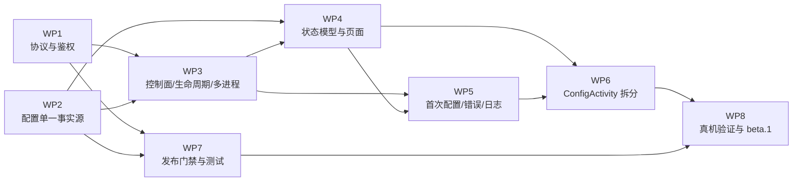

# 工作包拆分与执行指令

> 状态：**规划中，未实现**。所有工作包在计划冻结前不得改动代码。
> 架构依据：[architecture.md](architecture.md)。迁移依据：[migration.md](migration.md)。
> 规模：S ≈ 1 个可独立评审的改动；M ≈ 3~5 个；L ≈ 需要跨类重构 + 新测试。

## 0. 总览与依赖



| 编号 | 名称 | 规模 | 依赖 | 可并行 |
|---|---|---|---|---|
| WP1 | 协议与鉴权基础（HMAC / 会话 / 纯 JVM） | M | 无 | ✅ |
| WP2 | 配置单一事实源与迁移（rev / 备份 / 损坏） | L | 无 | ✅（与 WP1） |
| WP3 | 控制面、注册表、桥生命周期与多进程 | L | WP1、WP2 | ❌ |
| WP4 | 状态模型与主页/配置页改造 | M | WP2、WP3 | ❌ |
| WP5 | 首次配置、错误可行动、日志解耦 | M | WP3、WP4 | ❌ |
| WP6 | `ConfigActivity` 拆分与导入/导出/危险操作 | L | WP4、WP5 | ❌ |
| WP7 | 发布门禁与测试补齐 | M | WP1、WP2（测试可先行） | 部分 |
| WP8 | 真机验证与 `0.12.0-beta.1` 发布 | M | 全部 | ❌ |

> **顺序说明**：相对 README 建议把「配置单一事实源」提到 WP2、把「生命周期/多进程」放到 WP3。
> 原因：生命周期策略必须消费 `rev/shouldListen` 契约；先冻结配置契约可以避免 WP3 返工。
> 如果主 Agent 坚持原顺序，WP2 必须先只交付 `rev` 字段与 `ConfigCache` 接口。

---

## 1. 通用约束（每个工作包都适用）

**禁止修改**（除非该 WP 的「涉及文件」明确列出）：

- `app/src/main/AndroidManifest.xml` 的 `package`、签名相关配置、`minSdk/targetSdk`
- `keystore/`、`libs/`、`gradle.properties`、`settings.gradle.kts`
- 与小爱适配相关的 hook 目标类名/方法名（`sm.a`、`qm.i`、`qm.j`、`qm.b`、`um.h`、`sm.b$c/d`）
- 任何第三方依赖、Kotlin、Gradle 构建路径

**必须遵守**：

- Java 1.8 语法；无 `var`、无 `List.of`、无 `java.util.Base64`（Android API 26 有，但桌面 JDK 8 也可；
  为稳妥用项目内现有编码工具或 `android.util.Base64` 仅在 Android 层）。
- 纯 JVM 类不得 `import android.*`；`tests/run.sh` 能编译即证明。
- 后台任务走 `AppExecutors`；提示走 `BaseActivity.showMessage()`；资源走 `R.*`。
- 日志/异常/Toast 不得包含 apiKey、token、完整 config JSON。
- 失败即降级：任何新 hook / Binder / socket 异常只写日志，不影响模型重定向。
- 每个 WP 结束时：`./tests/run.sh` 与 `scripts/check-consistency.sh` 必须绿。

**测试命令**：

```bash
./tests/run.sh
scripts/check-consistency.sh
# 需要设备时（WP8）：
XIAOI_TOKEN=$(cat ~/.config/xiaoi/token) scripts/contract-test.sh --check
```

---

## WP1 协议与鉴权基础（HMAC / 会话 / 纯 JVM）

**规模**：M。

### 目标

交付一个无 Android 依赖的 `xiaoi-bridge/2` 协议实现：挑战-响应、会话密钥、请求 MAC、
重放/时间窗/限流策略，全部可桌面单测。

### 范围（必须做）

- 新增 `core/BridgeProtocol.java`：常量、canonical transcript、HMAC/HKDF、proof 生成与校验。
- 新增 `core/BridgeSessionStore.java`：`sid` 会话表、nonce LRU、TTL、失败计数、限流。
- 新增 `core/BridgeAuthClient.java`：App 侧构造 `/auth/begin`、校验 `serverProof`、生成请求头。
- 新增 `core/BridgeAuthServer.java`：服务端状态机（begin → 校验请求 MAC）。
- 所有比较使用 `MessageDigest.isEqual`；所有随机数通过注入的 `SecureRandom`（测试可确定）。
- 常量集中：`WINDOW_MS=120000`、`SESSION_TTL_MS=600000`、`IDLE_MS=120000`、
  `MAX_SESSIONS=8`、`NONCE_CACHE=256`、`BEGIN_PER_MIN=20`、`BEGIN_PER_HOUR=200`。

### 非范围（禁止做）

- 不接 Android、不改 `Bridge.java`、不改 `BridgeClient.java`、不改 `Http.java` 的响应格式。
- 不做 TLS、不做 PAKE、不做 payload 加密。
- 不实现业务端点鉴权接线（WP3 做）。

### 涉及文件

| 文件 | 动作 |
|---|---|
| `app/src/main/java/plus/xiaoi/module/core/BridgeProtocol.java` | 新增 |
| `app/src/main/java/plus/xiaoi/module/core/BridgeSessionStore.java` | 新增 |
| `app/src/main/java/plus/xiaoi/module/core/BridgeAuthClient.java` | 新增 |
| `app/src/main/java/plus/xiaoi/module/core/BridgeAuthServer.java` | 新增 |
| `tests/src/plus/xiaoi/module/BridgeProtocolTest.java` | 新增 |
| `tests/run.sh` | 加入新源文件与测试 |
| `tests/src/plus/xiaoi/module/TestMain.java` | 注册套件 |

### 验收标准（可判定）

1. `tests/run.sh` 在无 `android.jar` 情况下编译通过。
2. RFC 4231 的 HMAC-SHA256 向量（case 1~4）全部通过。
3. RFC 5869 的 HKDF-SHA256 向量（case 1~3）全部通过。
4. 对 `port/instance/clientNonce/serverNonce/clientTs/serverTs` 任一字段做 1 bit 篡改，
   `serverProof` 校验必须失败（6 个独立断言）。
5. 重放同一请求（同 sid + 同 nonce）第二次必须 401；换 nonce 但改 body 必须 401。
6. `ts` 偏差 121 s 必须拒绝；120 s 必须接受。
7. 同 sid 连续 5 次 MAC 失败后会话被销毁；第 6 次仍 401。
8. 第 21 次/分钟 `begin` 返回 429；跨分钟后恢复。
9. 序列化后的任何请求/响应字符串不包含 token 原文（用固定 token 断言 `indexOf(token)<0`）。
10. 代码评审检查：无 `String.equals` 比较 MAC、无 `Arrays.equals`、无 `==` 比较字节数组。

### 必须新增的测试

| 测试 | 类型 |
|---|---|
| `BridgeProtocolTest`：transcript 快照、篡改矩阵、时间窗、重放、限流、token 不出现 | 纯 JVM |
| `BridgeProtocolTest`：`BridgeAuthClient` 与 `BridgeAuthServer` 端到端（内存 transport） | 纯 JVM |
| `BridgeSessionStoreTest`（可并入）：TTL、空闲回收、容量上限、会话销毁 | 纯 JVM |

真机契约：本 WP 不涉及。

### 依赖与风险

- 依赖：无。
- 风险：canonical 字符串歧义；HKDF 实现错误；`SecureRandom` 在测试中的确定性注入。
- 缓解：transcript 采用「固定字段顺序 + 长度固定编码」；测试向量先于业务代码。

### 子 Agent 指令模板（可直接粘贴）

```text
【背景】
仓库 /home/chatxavier/code/xiaoi-plus 是 LSPosed 模块 + 设置 App。
当前桥的端口发现会把 Bearer Token 发给 8771~8775 的每个端口，本机恶意应用可占端口窃取。
重构方案要求新增 HMAC 挑战-响应协议 xiaoi-bridge/2，Token 永不上网。
你只做协议与鉴权的纯 JVM 层，不接 Android。

【目标】
在 app/src/main/java/plus/xiaoi/module/core/ 下实现 BridgeProtocol / BridgeSessionStore /
BridgeAuthClient / BridgeAuthServer，并用 tests/src/.../BridgeProtocolTest.java 覆盖。

【范围】
- /auth/begin：clientProof=HMAC(token,"C0\n"|port|ts|nonce)，服务端返回 serverProof。
- TH/K_id/K_mac 的派生严格按 docs/refactor/architecture.md §3.3。
- 请求 MAC：method|pathWithQuery|ts|nonce|sha256(body)。
- 时间窗 ±120s、会话 600s、空闲 120s、nonce LRU 256、begin 限流 20/min。
- 所有 MAC 比较用 MessageDigest.isEqual。

【禁止改的文件】
app/src/main/java/plus/xiaoi/module/Bridge.java
app/src/main/java/plus/xiaoi/module/BridgeClient.java
app/src/main/java/plus/xiaoi/module/BridgePusher.java
app/src/main/java/plus/xiaoi/module/Config*.java
app/src/main/AndroidManifest.xml
build.sh / .github/ / scripts/
不得新增任何第三方依赖，不得 import android.*。

【必须跑的测试】
./tests/run.sh
scripts/check-consistency.sh

【输出格式】
1) 变更文件列表与每个文件的作用（≤10 行/文件）
2) 新增测试断言数、覆盖的失败路径
3) 与 architecture.md §3.3 的逐条对照（字段/顺序/时间窗/限流）
4) 未解决项与风险

【完成定义】
- tests/run.sh 全绿，且新套件在 TestMain 中注册。
- 无 android import；无 token 出现在任何序列化字节里。
- 代码评审通过：常数时间比较、无自定义随机数、无 System.currentTimeMillis 之外的时钟源。
```

---

## WP2 配置单一事实源与迁移（rev / 备份 / 损坏）

**规模**：L。

### 目标

让 `config.json` 成为唯一事实源：schema v3、`rev` 单调、原子写 + `.bak`、损坏不静默回默认、
未知字段四层保留、迁移失败保留原文件。

### 范围（必须做）

- `AppConfig` 增加 `rev`、`updatedAt`、`mcp.tokenSetAt`；`mcp/provider/model` 各层增加 `extra`。
- `ConfigCodec` 支持 v3 读写；v2→v3 迁移；canonical JSON + `hash()`。
- 新增 `core/ConfigMigration.java`：纯函数 `migrate(Map) → AppConfig`，不碰文件。
- 新增 `core/ConfigBackup.java`：`.bak` 轮换、`config.json.corrupt.<ts>`、恢复选择。
- 改造 `ConfigRepository`：加载状态枚举（`VALID/INVALID/CORRUPT/MIGRATING/UNSUPPORTED`）、
  `revFloor`、`save()` 返回 `SaveResult{rev,hash}`；**删除 `pushAsync` 调用**。
- 删除「解析失败返回 defaults」的逻辑；首次无文件才允许生成默认骨架。
- `validate`：`mcp.enabled && token 为空` 必须拒绝；新增 token 长度/字符集检查（新 token ≥32 hex）。
- 写模块 prefs 时增加 `cfg_rev/cfg_hash/cfg_updated_at`；保留 legacy key。

### 非范围（禁止做）

- 不改 `Bridge.java`、`BridgeClient.java`、UI。
- 不实现 Provider（WP3）。
- 不改 `config.json` 的位置。
- 不删除 `AppConfig.VERSION=2` 的读取路径（迁移必须能读 v2）。

### 涉及文件

| 文件 | 动作 |
|---|---|
| `app/src/main/java/plus/xiaoi/module/AppConfig.java` | 加字段/extra |
| `app/src/main/java/plus/xiaoi/module/ConfigCodec.java` | v3 + canonical |
| `app/src/main/java/plus/xiaoi/module/ConfigRepository.java` | 状态/rev/备份/去推送 |
| `app/src/main/java/plus/xiaoi/module/core/ConfigMigration.java` | 新增 |
| `app/src/main/java/plus/xiaoi/module/core/ConfigBackup.java` | 新增 |
| `app/src/main/java/plus/xiaoi/module/core/ConfigRevision.java` | 新增（rev 规则纯函数） |
| `tests/src/plus/xiaoi/module/ConfigCodecTest.java` | 扩展 |
| `tests/src/plus/xiaoi/module/ConfigMigrationTest.java` | 新增 |
| `tests/src/plus/xiaoi/module/ConfigCorruptionTest.java` | 新增 |
| `tests/run.sh`、`TestMain.java` | 注册 |

### 验收标准

1. 一份真实 v2 样例（含 `themeMode`、未知字段 `x-foo`、`mcp.lan`）迁移后：
   `version=3`、`rev=1`、`themeMode` 丢弃、`x-foo` 保留、`mcp.lan` 保留。
2. 未知字段在顶层/`mcp`/provider/model 四层都能 round-trip。
3. 同一逻辑配置重复 `toJson` 输出字节完全一致；`hash()` 稳定。
4. `load()` 遇到非法 JSON 返回 `CORRUPT`，**不写文件**；原文件字节不变（断言文件哈希）。
5. `.bak` 存在且主文件损坏时，`recoverFromBackup()` 返回候选，但**不自动写**；用户确认后才替换。
6. `rev`：从 7 写一次变 8；外部把文件改成 rev=3 后再写变 `max(7,3)+1`。
7. `save()` 不再调用 `BridgePusher`（grep 断言）；桥不在线时保存仍返回成功。
8. `mcp.enabled=true, token=""` 校验失败；`token="short"` 失败；32 hex 通过。
9. `enabled=false, mcp.enabled=true` 校验通过（MCP-only 合法状态），即使没有 key。
10. 迁移失败（模拟只读目录）返回 `MIGRATION_FAILED`，原文件保留，后续 `save()` 拒绝。

### 必须新增的测试

| 测试 | 类型 |
|---|---|
| v2→v3 全字段迁移、未知字段四层、版本过高只读 | 纯 JVM |
| 损坏 JSON、截断文件、空文件、UTF-8 BOM | 纯 JVM |
| rev 单调、外部回退、并发写（两线程） | 纯 JVM |
| `.bak` 轮换与恢复 | 纯 JVM |
| 保存不依赖桥（不存在 HTTP 调用） | 纯 JVM + grep |

真机：`adb push` 一份 v2 文件 → 打开 App → 文件变 v3 且 hook 仍生效。

### 依赖与风险

- 依赖：无。
- 风险：迁移写坏唯一事实源；rev 并发；未知字段丢失。
- 缓解：先写 tmp + fsync + `.bak`；迁移失败只读；所有写路径单测覆盖。

### 子 Agent 指令模板（可直接粘贴）

```text
【背景】
config.json 目前是事实源，但解析失败会静默返回默认值，target prefs 还会把 bridge/marker
硬编码为 true；保存还会触发 HTTP 推送，导致「文件已写、UI 说失败」。
本工作包只做配置层：schema v3、rev、备份、损坏状态、迁移。

【目标】
让 config.json 成为唯一事实源；任何失败都不静默覆盖；保存不依赖桥在线。

【范围】
- AppConfig 增加 rev/updatedAt/tokenSetAt 与四层 extra。
- ConfigCodec 读写 v3；v2 迁移；canonical JSON + SHA-256。
- ConfigRepository 返回 LoadState/SaveResult；删除 pushAsync 调用。
- .bak 轮换与手动恢复；corrupt 副本。
- validate 拒绝 mcp.enabled + 空 token。

【禁止改的文件】
Bridge.java / BridgeClient.java / BridgePusher.java / Mcp.java
HomeActivity.java / ConfigActivity.java / LogsActivity.java
AndroidManifest.xml / build.sh / scripts/ / .github/
不得改 config.json 路径，不得引入依赖。

【必须跑的测试】
./tests/run.sh
scripts/check-consistency.sh

【输出格式】
1) schema v3 字段表与 v2 差异
2) 迁移算法伪代码 + 失败分支
3) 新增断言数与覆盖矩阵
4) 兼容性说明（0.11 读 v3 会怎样）

【完成定义】
- 损坏文件字节不被修改（有测试）。
- 保存路径无 HTTP。
- v2 样例迁移后可被 Hook 正常消费（真机或单测快照）。
```

---

## WP3 控制面、注册表、桥生命周期与多进程

**规模**：L。

### 目标

用 UID 白名单 Provider + 注册表替代端口扫描和配置推送；桥只在主进程、只由策略启动；
`mcp.enabled=false` 立即关闭全部监听。

### 范围（必须做）

- 新增 `control/BridgeControlProvider`（exported，方法级 UID 校验）：
  `pullConfig`、`register`、`unregister`、`state`、`log`、`writeConfig`。
- 新增 `control/UidGuard`：`Binder.getCallingUid()` 与 voiceassist UID 比对；缓存 60 s；
  非白名单抛 `SecurityException`；覆盖 `query/insert/update/delete/openFile/call`。
- 新增 `control/BridgeRegistry` + `InstanceRecord`：内存表 + 持久化提示（不含 token）。
- 新增 `bridge/BridgePolicy`（纯 JVM）：`shouldListen` / `bindHost` / `onConfigChanged`。
- 拆分 `Bridge.java` 为 `BridgeServer`（socket/HTTP）、`BridgeLifecycle`（start/stop/rebind）、
  `BridgeHost`（Mcp.Host）、`LogSink`；`Bridge.install` 只保留兼容壳或删除。
- 改造 `Hook`：用 `lp.processName` 只让主进程启动 `BridgeLifecycle`；其他进程只 hook + 拉配置。
- 新增 `core/RuntimeConfig`：内存快照 + `rev/hash`，替代 `Config.current()/forTarget()`。
- 删除 `BridgePusher`；删除 `BridgeClient.discover` 的 Bearer 广播；`/config` 返回 410。
- `/hello`、`/auth/begin` 接线到 `BridgeAuthServer`；业务端点支持 HMAC 或 Bearer。
- Manifest 注册 Provider；`android:exported="true"`、`grantUriPermissions="false"`。

### 非范围（禁止做）

- 不做 UI 状态展示（WP4）。
- 不做 bootstrap 配对码（WP5）。
- 不改 MCP 工具语义。
- 不做 payload 加密。

### 涉及文件

| 文件 | 动作 |
|---|---|
| `app/src/main/java/plus/xiaoi/module/control/BridgeControlProvider.java` | 新增 |
| `.../control/UidGuard.java` | 新增 |
| `.../control/BridgeRegistry.java` | 新增 |
| `.../control/InstanceRecord.java` | 新增 |
| `app/src/main/java/plus/xiaoi/module/bridge/BridgeServer.java` | 新增（从 Bridge 拆） |
| `.../bridge/BridgeLifecycle.java` | 新增 |
| `.../bridge/BridgeHost.java` | 新增 |
| `.../bridge/LogSink.java` | 新增 |
| `app/src/main/java/plus/xiaoi/module/core/BridgePolicy.java` | 新增 |
| `app/src/main/java/plus/xiaoi/module/core/RuntimeConfig.java` | 新增 |
| `app/src/main/java/plus/xiaoi/module/Hook.java` | 进程门控、RuntimeConfig |
| `app/src/main/java/plus/xiaoi/module/Bridge.java` | 删除或降为薄壳 |
| `app/src/main/java/plus/xiaoi/module/BridgePusher.java` | 删除 |
| `app/src/main/java/plus/xiaoi/module/BridgeClient.java` | 删除 discover；保留只读方法（HMAC 版） |
| `app/src/main/AndroidManifest.xml` | 注册 Provider |
| `tests/src/.../BridgePolicyTest.java` | 新增 |
| `tests/src/.../RegistryTest.java` | 新增 |
| `tests/src/.../BridgeServerTest.java` | 新增（本地 HTTP 桩） |

### 验收标准

1. 全机只有一个 877x 监听（`adb shell ss -ltn | grep 877` 只有一行）。
2. `mcp.enabled=false` 保存后 2 s 内端口消失；重启小爱后仍不监听。
3. `mcp.enabled=true, token 为空` 不监听；UI 无「可连接」假象。
4. Provider 被 `adb shell content call` 调用返回 `SecurityException`/拒绝（UID 2000 不在白名单）。
5. 桥启动后注册表出现一条记录，`port` 与 `ss` 一致；进程退出后 `lastSeen` 过期。
6. App 不再向任何端口发送 `Authorization` 做发现（grep：`BridgePusher` 不存在；
   `discover` 无 Bearer）。
7. `/config` 在 0.12 返回 410，响应体含可行动提示，不含任何配置内容。
8. `BridgePolicyTest` 覆盖 8 种输入组合（enabled/token/lan/version/safeMode）。
9. 多进程：`com.miui.voiceassist:core` 不监听，但仍完成 Hook；注册表可显示 hook-only 实例。
10. 配置变更通过 `notifyChange` 到达桥，≤2 s 应用（真机）。

### 必须新增的测试

| 测试 | 类型 |
|---|---|
| `BridgePolicyTest`：shouldListen/bindHost/rebind 组合 | 纯 JVM |
| `RegistryTest`：UID 拒绝、实例过期、重复 instance、端口范围 | 纯 JVM（UID 用策略函数模拟） |
| `BridgeServerTest`：/hello 无秘密、/auth/begin 失败、/config 410、MCP 关闭 404 | 纯 JVM |
| 真机契约：Provider 拒绝 shell、单端口、关闭即停 | 真机 |

### 依赖与风险

- 依赖：WP1（HMAC）、WP2（rev/ConfigCache）。
- 风险：MIUI 限制后台启动 Provider；Binder 回注册生命周期；`ContentObserver` 跨应用不触发。
- 缓解：60 s 轮询兜底；Provider 失败用 target 缓存；WP8 真机验证三种进程组合。

### 子 Agent 指令模板（可直接粘贴）

```text
【背景】
桥目前在每个 voiceassist 进程无条件 startServer，App 通过扫描 8771~8775 + Bearer 发现端口，
并把整份配置（含 apiKey）POST 过去。本工作包改为：
控制面 Provider（UID 白名单）+ 注册表 + 主进程单桥 + 策略化生命周期；HTTP 只服务外部客户端。

【目标】
1) App 不再扫描端口、不再发 Bearer 做发现、不再 HTTP 推配置。
2) mcp.enabled=false 时没有任何 877x 监听，重启后仍关闭。
3) 只有主进程监听；其他进程只 hook。

【范围】
- BridgeControlProvider 六个方法 + UidGuard 全方法拒绝。
- BridgeRegistry/InstanceRecord（持久化不含 token）。
- BridgePolicy（纯 JVM）+ BridgeServer/BridgeLifecycle/BridgeHost/LogSink 拆分。
- /hello、/auth/begin；/config → 410；BridgePusher 删除。
- Hook 进程门控；RuntimeConfig 替代 Config.current() 的 target 读取。

【禁止改的文件】
ConfigCodec.java / AppConfig.java（WP2 已冻结，只读）
HomeActivity.java / ConfigActivity.java / LogsActivity.java（WP4/WP5 做）
MCP 工具名与 JSON-RPC 语义
build.sh / scripts/ / .github/ / keystore/

【必须跑的测试】
./tests/run.sh
scripts/check-consistency.sh
# 有设备时
adb shell ss -ltn | grep 877 || true
XIAOI_TOKEN=... scripts/contract-test.sh --check   # 允许先更新基线，见 WP7

【输出格式】
1) 新旧调用链对照（发现/配置/日志/状态）
2) Provider 方法表与 UID 校验点
3) 生命周期状态机与 8 种策略组合结果
4) 端口/进程验证记录（命令 + 输出）
5) 残余风险

【完成定义】
- 全机单监听；关闭即停；重启仍停。
- 代码中不存在「向未认领端口发送 Authorization」的路径。
- Provider 对非 voiceassist UID 全部拒绝。
- 新增纯 JVM 测试全绿。
```

---

## WP4 状态模型与主页/配置页改造

**规模**：M。

### 目标

用四维状态模型替代「已启用/可用/已确认」混用；模型校验只影响端点维度；只有桥能声明运行时。

### 范围（必须做）

- 新增 `core/StateModel.java`：四维枚举、`derive(Input) → UiState`、迁移函数。
- 新增 `core/RuntimeStatus.java`：桥上报字段的不可变快照（`appliedRev/runtimeActive/runtimeModel/port/...`）。
- 重写 `StatusResolver` 为 `StateModel` 的适配层或删除；保留 `AppStatus` 词汇但新增
  `APPLY_PENDING / BRIDGE_DOWN / CORRUPT / HOOK_MISSING`。
- `HomeActivity`：
  - Hero 只消费 `StateModel`；删除 `renderStatus(c, true, m.id)` 这类伪造。
  - `testModel()` 只更新 D2；成功后文案「端点可用」而不是「已确认」。
  - 数字砖/最后错误来自 `DiagnosticsStore` + 注册表，不再依赖 `/stats`、`/logs`。
- 配置页状态条：显示 D1/D3/D4 三段（配置 / 已应用 rev / 运行时），D2 单独一行。
- 暂停态：移除模型卡触摸屏蔽；只禁用「校验模型」。
- 字符串入 `strings.xml`（本 WP 新增的文案必须走资源）。

### 非范围（禁止做）

- 不拆分 `ConfigActivity`（WP6）。
- 不改导入/导出（WP6）。
- 不做 bootstrap（WP5）。
- 不改桥协议。

### 涉及文件

| 文件 | 动作 |
|---|---|
| `app/src/main/java/plus/xiaoi/module/core/StateModel.java` | 新增 |
| `app/src/main/java/plus/xiaoi/module/core/RuntimeStatus.java` | 新增 |
| `app/src/main/java/plus/xiaoi/module/AppStatus.java` | 扩展枚举 |
| `app/src/main/java/plus/xiaoi/module/StatusResolver.java` | 改造/删除 |
| `app/src/main/java/plus/xiaoi/module/StatusCache.java` | 只存 D2 |
| `app/src/main/java/plus/xiaoi/module/HomeActivity.java` | 重写状态渲染 |
| `app/src/main/java/plus/xiaoi/module/ConfigActivity.java` | 状态条/暂停编辑（最小改动） |
| `app/src/main/res/layout/activity_home.xml` | 如需新增状态行 |
| `app/src/main/res/values/strings.xml`、`values-night` | 文案 |
| `tests/src/.../StateModelTest.java` | 新增 |
| `tests/src/.../StatusResolverTest.java` | 迁移/扩展 |

### 验收标准

1. `StateModelTest` 覆盖迁移表全部 10 个事件；每个事件的四维结果与 architecture.md §9.2 一致。
2. 模型校验成功（D2=OK）时 D4 不变；单测断言 `runtimeActive` 输入不被 `probe` 改写。
3. 只有 `D4=ACTIVE && D3=APPLIED && rev/model 一致` 才输出「运行中/已确认」。
4. 暂停态：provider/model/key 输入框 `isEnabled()==true`、可点击；「校验模型」禁用。
5. MCP 关闭时 Hero 仍能显示「运行中 · MCP 已关闭」（前提：模型重定向 active）。
6. 所有新增文案在 `strings.xml`；`check-consistency.sh` 不死资源。
7. 主页不再调用 `BridgeClient.discover`（grep）。

### 必须新增的测试

| 测试 | 类型 |
|---|---|
| 四维迁移表、伪造防护（probe 不改 D4） | 纯 JVM |
| UI 文案映射（状态 → 标题/副行/颜色） | 纯 JVM（返回文案 key） |
| 暂停编辑策略 | 纯 JVM（策略函数） |

真机：暂停/恢复、MCP 开关、模型切换三种组合下的 Hero 文案。

### 依赖与风险

- 依赖：WP2（rev）、WP3（RuntimeStatus 来源）。
- 风险：UI 改动面大、旧 `StatusResolverTest` 失效；状态来源仍可能被页面各自解释。
- 缓解：`StateModel` 是唯一出口；页面只做渲染；旧测试迁移而不是删除。

### 子 Agent 指令模板（可直接粘贴）

```text
【背景】
主页把「模型校验成功」当成「小爱已确认」，配置页又把暂停态整卡锁死；MCP 开关还绑架了
日志与运行时确认。本工作包引入四维状态模型，页面只渲染，不再各自推断。

【目标】
配置有效 / 端点可达 / 已应用 / 小爱运行时在用 四个维度分离；只有桥能写运行时。

【范围】
- core/StateModel + RuntimeStatus（纯 JVM）。
- AppStatus 扩展；StatusResolver 迁移。
- HomeActivity Hero/数字砖/错误行改造；ConfigActivity 状态条与暂停编辑。
- 新增文案走 strings.xml。

【禁止改的文件】
Bridge*.java / control/* / ConfigCodec.java / AppConfig.java
导入导出逻辑（WP6）
AndroidManifest.xml / scripts/ / tests/run.sh（除注册测试）

【必须跑的测试】
./tests/run.sh
scripts/check-consistency.sh

【输出格式】
1) 四维定义与数据源表
2) 迁移表逐行对照
3) 页面改动清单（控件 ID）
4) 「已确认」唯一判定条件
5) 真机验证步骤

【完成定义】
- 单测证明 probe 成功不改 D4。
- 暂停态可编辑。
- 所有「已确认」只来自 D4。
```

---

## WP5 首次配置、错误可行动、日志解耦

**规模**：M。

### 目标

首次配置可闭环（Provider 主路径 + 岛配对码兜底）；保存不再假失败；日志/诊断不再依赖 MCP。

### 范围（必须做）

- 新增 `bridge/PairingController` + `core/PairingCode`：6 位码、5 分钟、3 次、一次性。
- `/pair` 端点（仅 loopback，仅 `UNPAIRED` 状态）。
- 超级岛显示配对码；失败提示（无岛 → 显示「打开 App / ADB」）。
- 新增 `control/DiagnosticsStore`：App 私有日志文件 + 最近状态；桥批量推送（≤50 行/次，2 s）。
- `LogsActivity` 改为读本地 Store；「实时」通过 `Messenger.flushLogs`；MCP 关闭仍可用。
- 新增 `core/ErrorCatalog`：错误码 → 用户文案 + 下一步动作 + 是否可重试。
- `ConfigActivity` 的 `failureReason`/`renderPush` 改为消费 `ErrorCatalog` 与 `appliedRev`；
  删除「MCP 令牌与桥不一致」这类基于 401 的猜测。
- 首次配置清单卡片（5 项）与三条退出路径（见 architecture.md §10.2）。

### 非范围（禁止做）

- 不做 `ConfigActivity` 大拆分（WP6）。
- 不做导入确认（WP6）。
- 不改 HMAC 协议。

### 涉及文件

| 文件 | 动作 |
|---|---|
| `app/src/main/java/plus/xiaoi/module/bridge/PairingController.java` | 新增 |
| `app/src/main/java/plus/xiaoi/module/core/PairingCode.java` | 新增 |
| `app/src/main/java/plus/xiaoi/module/bridge/BridgeServer.java` | 加 `/pair` |
| `app/src/main/java/plus/xiaoi/module/control/DiagnosticsStore.java` | 新增 |
| `app/src/main/java/plus/xiaoi/module/core/ErrorCatalog.java` | 新增 |
| `app/src/main/java/plus/xiaoi/module/LogsActivity.java` | 改本地 Store |
| `app/src/main/java/plus/xiaoi/module/ConfigActivity.java` | 错误映射/清单 |
| `app/src/main/res/layout/activity_config.xml` | 清单卡片 |
| `tests/src/.../PairingCodeTest.java` | 新增 |
| `tests/src/.../ErrorCatalogTest.java` | 新增 |
| `tests/src/.../DiagnosticsStoreTest.java` | 新增（纯逻辑部分） |

### 验收标准

1. 首次安装（无 config.json、无 token、MCP 默认关）：能保存草稿并退出；不出现任何失败弹窗。
2. 打开 MCP：自动生成 32 hex token；provider 可用时 2 s 内注册；不可用时进入 `UNPAIRED`。
3. `/pair`：正确码成功一次；第二次 410；错误码 3 次后锁定；5 分钟后过期。
4. MCP 关闭时日志页仍显示最近 hook 日志（来自 DiagnosticsStore）；不提示「去开 MCP」。
5. 桥离线时保存：提示「已保存 rev N，等待小爱启动」；不出现「令牌不一致」。
6. 所有错误文案包含「下一步做什么」；`ErrorCatalogTest` 覆盖 ≥10 个错误码。
7. 日志/错误/导出中不出现 `apiKey` 或 `token` 原文（测试用固定密钥扫描）。

### 必须新增的测试

| 测试 | 类型 |
|---|---|
| `PairingCode`：生成/过期/尝试次数/一次性/常数时间比较 | 纯 JVM |
| `ErrorCatalog`：错误码映射、可重试、文案含动作 | 纯 JVM |
| `DiagnosticsStore`：环形裁剪、脱敏、批量上限 | 纯 JVM/Android 分离 |
| 真机：无 Provider 时岛配对、MCP 关闭日志、首次保存 | 真机 |

### 依赖与风险

- 依赖：WP3（Provider/注册表）、WP4（状态词汇）。
- 风险：岛在部分 ROM 不可用；Provider 后台限制；日志推送频率影响功耗。
- 缓解：批量 + 2 s 节流；岛失败降级 ADB/App 提示；日志只保留最近 1000 行。

### 子 Agent 指令模板（可直接粘贴）

```text
【背景】
首次配置存在假失败：MCP 关闭时 token 行隐藏，但保存仍去推 /config，401 被翻译成
「MCP 令牌与桥不一致」；日志页在 MCP 关闭时完全不可用；配对没有兜底。
本工作包让首次配置可闭环，并让诊断与 MCP 解耦。

【目标】
1) 保存只依赖文件，不依赖桥。
2) Provider 不可用时能用超级岛配对码完成配对。
3) MCP 关闭仍能看日志。
4) 错误文案可行动。

【范围】
- PairingController/PairingCode + /pair（loopback、一次性、5 分钟、3 次）。
- DiagnosticsStore + 桥批量推送 + LogsActivity 本地读。
- ErrorCatalog + ConfigActivity 错误映射（删除 401 猜测）。
- 首次配置清单与三条退出路径。

【禁止改的文件】
BridgeProtocol.java / BridgeSessionStore.java（WP1）
ConfigCodec.java / ConfigRepository.java（WP2，只读）
core/StateModel.java（WP4，只读）
导入导出（WP6）
AndroidManifest.xml / scripts/ / .github/

【必须跑的测试】
./tests/run.sh
scripts/check-consistency.sh

【输出格式】
1) bootstrap 状态机与失败分支
2) 错误码表（码/文案/动作/可重试）
3) 日志脱敏策略
4) 真机步骤与预期

【完成定义】
- 桥离线保存成功且无假失败文案。
- MCP 关闭日志可用。
- 配对码全部约束有单测。
```

---

## WP6 `ConfigActivity` 拆分与导入/导出/危险操作确认

**规模**：L。

### 目标

把 1600+ 行页面拆成可维护的 section/controller；导入必须二次确认并展示 diff；
危险操作（含密钥导出、清空 token、关闭 LAN）有明确确认与可撤销说明。

### 范围（必须做）

- 拆出 `ui/config/ConfigPageController`、`ProviderSection`、`ModelSection`、`McpSection`、
  `PrefixSection`、`BackupSection`、`DangerZoneSection`。
- 导入：解析 → 校验 → 展示 diff（providers/models/mcp 开关/token 是否变化/密钥是否存在）
  → 用户确认 → 写文件（`.bak` 保留）→ notify。
- 导出：脱敏默认；含密钥导出二次确认；导出文件名带版本与日期。
- 危险操作确认：轮换 token、清空 token、关闭 LAN、删除 provider、恢复备份。
- LAN 开关：明确「保存后生效」徽标；脏状态 banner；不允许在未保存时显示「已生效」。
- 删除 `ConfigActivity` 内联的推送状态机，改为 `StateModel` + `ErrorCatalog`。

### 非范围（禁止做）

- 不改协议/Provider/配置 schema。
- 不引入 Fragment/Compose/第三方 UI 库。
- 不改导航结构（仍是 4 Activity）。

### 涉及文件

| 文件 | 动作 |
|---|---|
| `app/src/main/java/plus/xiaoi/module/ui/config/*.java` | 新增（6~7 个类） |
| `app/src/main/java/plus/xiaoi/module/ConfigActivity.java` | 缩为壳 |
| `app/src/main/res/layout/activity_config.xml` | 拆分 include |
| `app/src/main/res/layout/item_*.xml` | 新增 section 布局 |
| `app/src/main/res/values/strings.xml` | 文案 |
| `app/src/main/java/plus/xiaoi/module/core/ImportPlan.java` | 新增（diff 纯逻辑） |
| `tests/src/.../ImportPlanTest.java` | 新增 |

### 验收标准

1. `ConfigActivity.java` ≤ 300 行；每个 section ≤ 250 行；无业务校验散落在 View 层。
2. 导入前必出确认对话框；取消后文件字节不变；确认后 `.bak` = 旧文件。
3. diff 至少展示：provider 数、model 数、`enabled`、`mcp.enabled/lan`、token 是否变化、
   密钥是否存在（不显示明文）。
4. 含密钥导出必须二次确认；脱敏文件导入被阻断（沿用现有规则）。
5. 轮换/清空 token、关闭 LAN、删除 provider 都有确认；确认文案说明影响。
6. LAN 开关改动后显示「未保存 · 保存后重绑」；保存后显示「已应用 rev N」。
7. 现有 UI 回归：深浅主题、旋转保留草稿、冲突条、返回栈。

### 必须新增的测试

| 测试 | 类型 |
|---|---|
| `ImportPlan`：新增/删除/修改 provider/model、token 变化、脱敏阻断 | 纯 JVM |
| 危险操作确认策略（纯函数：动作 → 是否需要确认/文案 key） | 纯 JVM |
| 真机：导入取消/确认、导出、LAN 脏状态 | 真机 |

### 依赖与风险

- 依赖：WP4（状态）、WP5（错误目录）。
- 风险：拆分引入回归；XML include 的 ID 冲突；草稿恢复。
- 缓解：先抽 controller 再抽 view；每步跑真机冒烟；保留 `onSaveInstanceState` 行为。

### 子 Agent 指令模板（可直接粘贴）

```text
【背景】
ConfigActivity 约 1685 行，导入只载入不确认、危险操作没有统一确认、LAN 开关只改草稿
却可能被理解成已生效。本工作包只做页面拆分与安全交互，不改协议。

【目标】
1) ConfigActivity ≤300 行，逻辑按 section 拆分。
2) 导入必须确认并展示 diff。
3) 危险操作统一确认。
4) LAN/脏状态表达准确。

【范围】
- ui/config/* 拆分；activity_config.xml include。
- ImportPlan 纯逻辑 + 测试。
- 确认对话框统一由 DangerZone/BackupSection 提供。
- 删除页面内推送状态机，接 StateModel/ErrorCatalog。

【禁止改的文件】
core/* / control/* / bridge/* / Hook.java
ConfigCodec.java / ConfigRepository.java / AppConfig.java
AndroidManifest.xml / scripts/ / .github/ / build.sh

【必须跑的测试】
./tests/run.sh
scripts/check-consistency.sh
# 真机冒烟：安装、配置、暂停、导入取消/确认、导出、LAN 开关

【输出格式】
1) 拆分前后行数对比
2) ImportPlan diff 字段表
3) 危险操作 → 确认文案表
4) 回归清单与结果

【完成定义】
- 行数达标，功能无回归。
- 导入取消不写文件（有测试/真机记录）。
- 所有危险操作有确认。
```

---

## WP7 发布门禁与测试补齐

**规模**：M。

### 目标

让「未签名/未跑测试/未跑一致性」的构建无法发布；让 tag 构建在缺少正式密钥时**不创建 Release**。

### 范围（必须做）

- `scripts/check-consistency.sh` 增加：
  - 禁止 `BridgePusher`、`discover(` 携带 Bearer；
  - 禁止 `XSharedPreferences` 出现在 target 配置读取路径（仅允许 legacy 白名单）；
  - 禁止 `mcp.enabled` 之外的条件启动 `ServerSocket`（grep `startServer` 调用点）；
  - 禁止 `Toast.makeText`、`getIdentifier`、裸 `new Thread`（沿用）；
  - 新增测试源必须在 `tests/run.sh` 注册。
- 新增 `scripts/verify-apk.sh`：`apksigner verify --print-certs` + `aapt2 dump badging`
  + 证书 SHA-256 与 `keystore/xiaoi.keystore` 比对 + 包名/versionCode 断言。
- `scripts/release.sh`：构建后必须跑 `verify-apk.sh`；失败即中止；删除产物。
- `.github/workflows/build.yml`：
  - Build 前跑 `scripts/check-consistency.sh`；
  - tag 构建若 `steps.sign.outputs.signed != true` → **job 失败或跳过 Release**（二选一，推荐失败）；
  - PR/branch 构建允许临时签名，但不得创建 Release。
- `tests/run.sh` 注册 WP1~WP6 新增测试。
- `scripts/contract-test.sh` 更新：`/config` 期望 410；新增 `/hello`、`/auth/begin` 断言；
  `tests/baseline/` 重新生成并在 PR 中说明差异。
- `docs/ci.md`、`docs/release.md` 同步。

### 非范围（禁止做）

- 不改业务代码。
- 不改签名密钥。
- 不引入 GitHub Actions 第三方 action（除既有官方 action）。

### 涉及文件

| 文件 | 动作 |
|---|---|
| `scripts/check-consistency.sh` | 扩展规则 |
| `scripts/verify-apk.sh` | 新增 |
| `scripts/release.sh` | 接入 verify |
| `scripts/contract-test.sh` | 新端点/410/基线 |
| `.github/workflows/build.yml` | 一致性步骤 + tag 门禁 |
| `tests/run.sh` | 注册新测试 |
| `tests/baseline/*` | 更新 |
| `docs/ci.md`、`docs/release.md`、`CHANGELOG.md` | 同步 |

### 验收标准

1. 故意引入一个 `Toast.makeText` → `check-consistency.sh` 失败。
2. 故意让 `release.sh` 使用未签名 APK → 脚本非零退出，`dist/` 不产生新文件。
3. 故意把 tag 指向无 `KEYSTORE_BASE64` 的仓库 → workflow 不创建 Release（job 失败）。
4. `verify-apk.sh` 能检出：未签名、包名错误、versionCode 不符、证书指纹不符。
5. `tests/run.sh` 包含 WP1~WP6 全部新套件；断言总数记录在 CHANGELOG。
6. `contract-test.sh --check` 在新协议下通过；基线 diff 有说明。
7. `./scripts/check-all.sh --no-device` 全绿。

### 必须新增的测试

| 测试 | 类型 |
|---|---|
| 门禁负向测试：临时注入违规代码 → 脚本必须失败 | shell（本地手动/CI） |
| `verify-apk` 负向：未签名/错包名 | shell |
| CI 逻辑：tag + 无 secrets | workflow 试跑（fork/手动） |

### 依赖与风险

- 依赖：WP1/WP2（测试先落地），其余可与 WP6 并行。
- 风险：CI 改动导致正常构建被卡；基线更新掩盖回归。
- 缓解：门禁规则先 warning 一个 PR，再变 error；基线 diff 必须人工 review。

### 子 Agent 指令模板（可直接粘贴）

```text
【背景】
当前 CI 不跑 check-consistency，release.sh 不验证 APK 是否真的签名，tag 构建在缺正式
密钥时会用临时密钥建 Release。本工作包只改门禁/脚本/CI/测试注册，不改业务代码。

【目标】
1) CI 必跑单测 + 一致性。
2) release.sh 必跑 apksigner verify + 证书/包名/版本断言。
3) tag 无正式密钥不得创建 Release。
4) 新测试全部注册。

【范围】
- check-consistency 新规则（BridgePusher/discover Bearer/XSharedPreferences/startServer）。
- verify-apk.sh + release.sh 接入。
- build.yml 一致性步骤 + tag 签名门禁。
- contract-test 新端点与 410；基线更新。
- 文档同步。

【禁止改的文件】
app/src/main/java/**（除测试注册所需的 tests/）
app/src/main/AndroidManifest.xml
keystore/
不得改签名密钥、不得引入第三方 action。

【必须跑的测试】
./tests/run.sh
scripts/check-consistency.sh
scripts/release.sh --allow-dirty --allow-new-key   # 仅本地验证，确认会拒绝未签名
# 观察 GitHub Actions：branch / tag 两种路径

【输出格式】
1) 门禁规则表（规则/失败信息/误报风险）
2) verify-apk 检查项与输出样例
3) CI 改动前后对比
4) 基线 diff 说明
5) 仍需人工确认的事项

【完成定义】
- 三个负向场景都能被拦住（有命令输出）。
- 正常分支构建仍绿。
- 文档与脚本一致。
```

---

## WP8 真机验证与 `0.12.0-beta.1` 发布

**规模**：M。

### 目标

在真实 MIUI/HyperOS 设备上验证 P0 场景，完成 `0.12.0-beta.1` 发布候选。

### 范围（必须做）

- 版本号：`AndroidManifest.xml` → `versionCode=16`、`versionName=0.12.0-beta.1`。
- `CHANGELOG.md` 新增小节；`docs/security.md`、`docs/architecture.md`、`HANDOVER.md` 更新。
- 真机回归 P0（见 migration.md §6）全部执行并记录命令/输出。
- 覆盖三种配置来源：Provider 正常、Provider 被 force-stop、target 缓存-only。
- 覆盖三种进程组合：主进程 + `:core` + `:voice_trigger`。
- 覆盖 MIUI prefs 重定向设备（当前真机）。
- 生成基线、跑契约、记录 `ss -ltn`。
- 发布：`scripts/release.sh` → tag → CI → Release（prerelease）。

### 非范围（禁止做）

- 不带未合并的 WP 发布。
- 不用临时密钥发正式 Release。
- 不在本 WP 修业务 bug（发现即回退到对应 WP）。

### 涉及文件

| 文件 | 动作 |
|---|---|
| `app/src/main/AndroidManifest.xml` | 版本号 |
| `CHANGELOG.md` | 新小节 |
| `docs/security.md`、`docs/architecture.md`、`HANDOVER.md` | 同步 |
| `tests/baseline/*` | 重新生成 |
| `dist/` | 发布产物（不入库） |

### 验收标准

1. `versionCode=16`、`versionName=0.12.0-beta.1`；覆盖安装成功，配置/Token 不丢。
2. P0 清单 100% 通过（见 migration.md §6）。
3. `ss -ltn`：MCP 开 → 一个 877x；MCP 关 → 零个；重启小爱后保持。
4. `contract-test.sh --check` 全绿；`check-all.sh` 全绿。
5. 日志中无 apiKey/token；导出脱敏正确。
6. Release 附件签名指纹与上一版一致；notes 标注不兼容项（`/config` 410）。

### 必须新增的测试

真机契约与 P0 回归，不新增 JVM 测试。

### 依赖与风险

- 依赖：WP1~WP7。
- 风险：MIUI 后台限制、Provider 启动失败、岛不可用、端口占用。
- 缓解：准备 fallback 脚本（ADB 注入、缓存-only），并记录每种失败的用户可见文案。

### 子 Agent 指令模板（可直接粘贴）

```text
【背景】
0.12.0-beta.1 是控制面/配置/状态重构后的首个测试版。需要真机验证并发布。

【目标】
在真实设备完成 P0 回归，更新版本与文档，产出可覆盖安装的 beta APK。

【范围】
- 版本号 +16 / 0.12.0-beta.1。
- 执行 migration.md §6 的 P0 清单，记录命令与输出。
- 覆盖 Provider 正常/被停/缓存-only；主进程/:core/:voice_trigger。
- 更新 CHANGELOG/security/architecture/HANDOVER。
- release.sh + tag + CI。

【禁止改的文件】
除版本号与文档外，不改 app/ 业务代码；不改脚本门禁；不换签名。

【必须跑的测试】
./tests/run.sh
scripts/check-consistency.sh
scripts/check-all.sh
XIAOI_TOKEN=$(cat ~/.config/xiaoi/token) scripts/contract-test.sh --check
adb shell ss -ltn | grep 877 || true
adb install -r build/xiaoi-plus.apk

【输出格式】
1) P0 清单逐项 PASS/FAIL + 证据（命令输出/截图路径）
2) 失败项归因到工作包
3) 签名指纹对比
4) 发布链接与 SHA-256
5) 已知问题

【完成定义】
- P0 全绿，或失败项有明确阻塞结论。
- 版本/文档/基线一致。
- Release 为 prerelease，签名与上一版一致。
```

---

## 2. 工作包交付检查表（主 Agent 用）

每个 WP 合并前必须回答：

- [ ] 是否只改了「涉及文件」？越界是否说明理由？
- [ ] 新增类是否在正确的包（core 无 android import）？
- [ ] 是否新增了失败路径测试，而不只是 happy path？
- [ ] 是否有任何日志/异常/Toast 可能带出 apiKey/token？
- [ ] 是否更新了 `tests/run.sh` 与 `TestMain`？
- [ ] 是否让 `check-consistency.sh` 仍然通过？
- [ ] 是否在 `CHANGELOG.md` 或对应 docs 记录了行为变化？
- [ ] 是否留下「以后再做」的 TODO？如果有，写进 risks.md 的开放问题。
