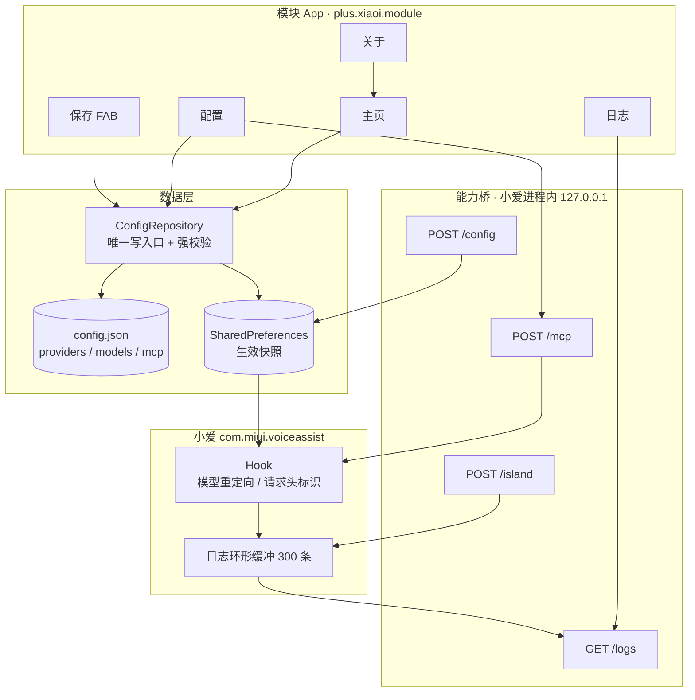
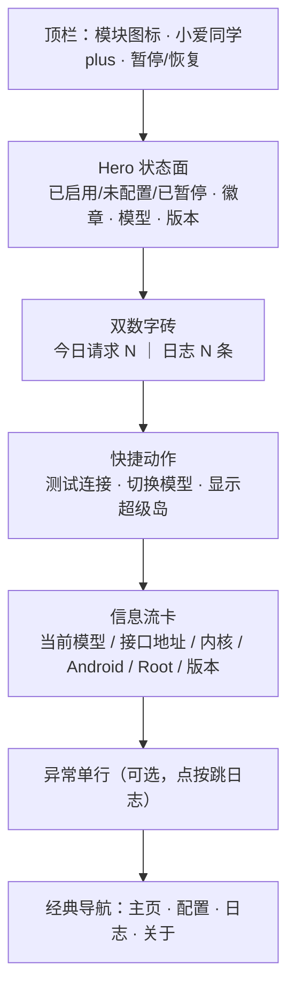
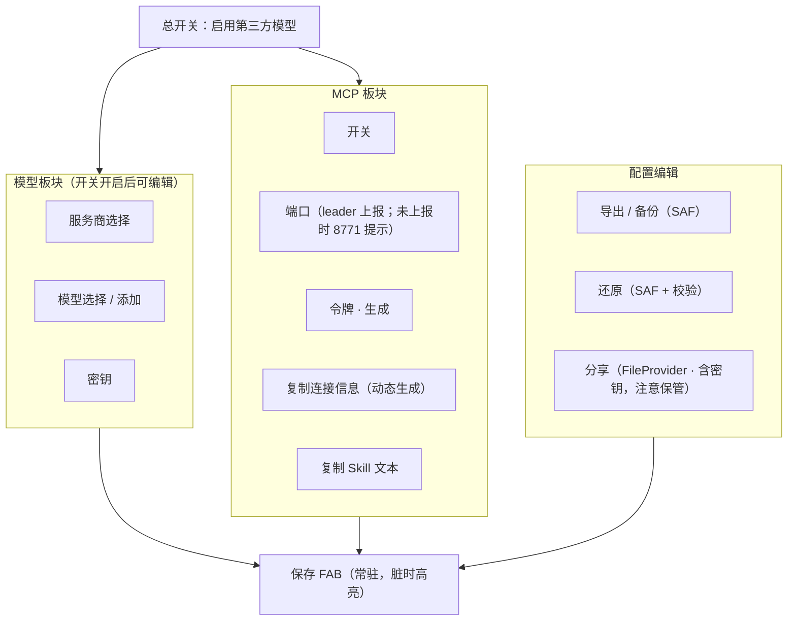
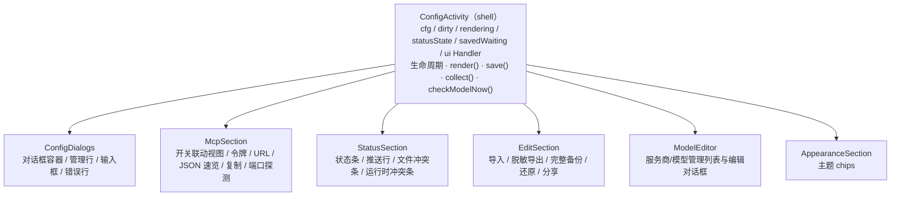
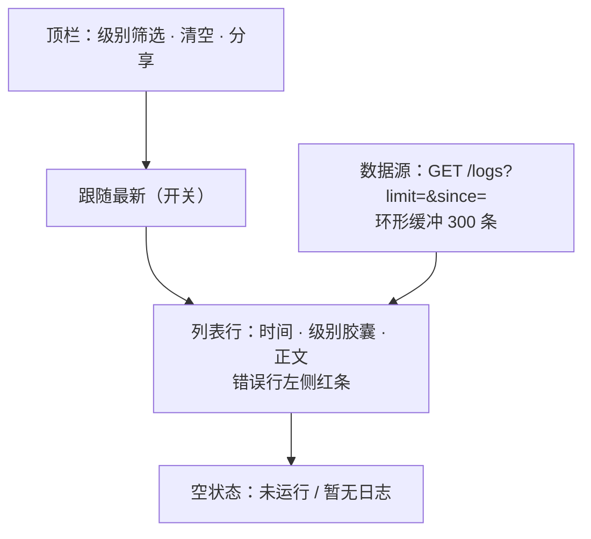
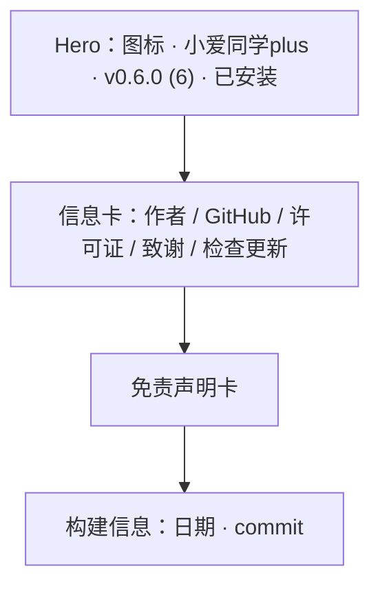
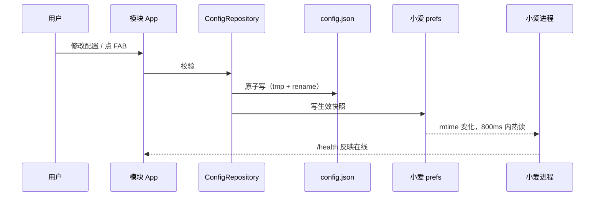
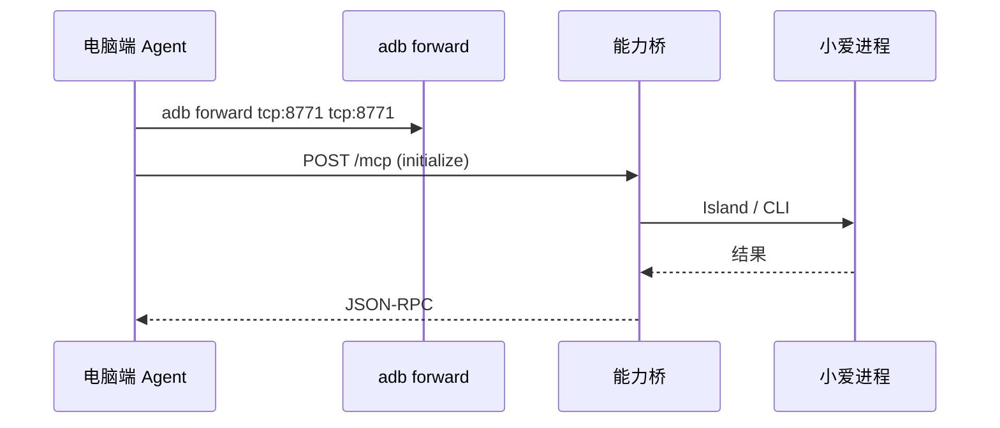
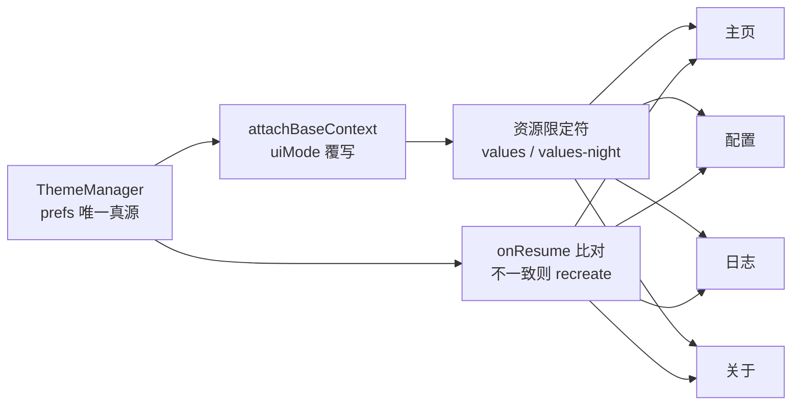

# 小爱同学plus · UI 与模块架构

> 版本：0.7 规划（四页结构）
> 说明：Mermaid 图在 GitHub / 支持 Mermaid 的 Markdown 渲染器中可直接显示。

## 0. 总体架构



**文字版（同样的关系）**

```
模块 App
 ├─ 主页 ──┐
 ├─ 配置 ──┼─> ConfigRepository（校验 / 原子写 / 单一入口）
 ├─ 日志 ──┘        ├─> config.json（唯一事实源）
 ├─ 关于              └─> SharedPreferences（生效快照）
 └─ FAB(保存)              │
                           ▼
                    小爱进程 800ms 热读
                           │
        ┌──────────────────┼──────────────────┐
        ▼                  ▼                  ▼
   Hook: 重定向/标识    日志环形缓冲        能力桥
                                          /mcp /logs /island /config
```

## 1. 主页



数据来源：`ConfigRepository`（配置）、能力桥 `/health`（在线）、`/logs`（计数）。

## 2. 配置



校验规则：`baseUrl` http(s)、`model` 非空、`apiKey` 非空；不通过则阻止开启并提示。

### 2.1 配置页类结构（0.12.0 WP5，机械拆分）

`ConfigActivity` 只保留状态所有权与流程编排；纯视图/对话框移到 `plus.xiaoi.module.ui.config`，
不改变任何布局 ID、文案与点击行为。Section 不持有 Activity：构造时传入 root View、宿主
`AppConfig` 读取接口与必要的 `Runnable`/小接口，状态更新仍回调 Activity。



模型 chips 的渲染与“选中服务商/模型”仍留在 `ConfigActivity`（它们同时改 cfg、状态条与自动校验），
`ModelEditor` 只接管管理/编辑对话框。文件选择器结果仍由 Activity 的 `onActivityResult`
转发给 `EditSection`。

## 3. 日志（独立页）



## 4. 关于



链接：`https://github.com/xuanyuanluoxue/xiaoi-plus`（作者 轩辕落雪，GPL-3.0）。

## 5. 数据流





## 6. 深色模式



- 主题不写入 `config.json`，`ConfigSync` 也不会再回写 prefs
- 任何页面切换主题后，其余页面在下次 `onResume` 时自动重建
- 配置页切主题时未保存的编辑随 Bundle 恢复，不会被文件版本覆盖
