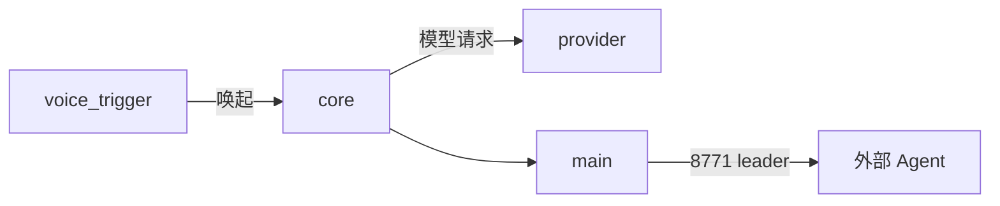

# 01 架构：进程与组件

> 证据级别：实测（进程/日志）+ 静态（Manifest）｜适用版本：8.2.70.8421

## 1. 进程模型

小爱不是单进程应用。在 M332BF / Android 17 上观察到 4 个进程（同一 APK、同一 uid）：

| 进程 | 作用（观察） | 典型日志 |
|---|---|---|
| `com.miui.voiceassist` | 主进程；**8771 leader** 通常在这里 | `已获得数据面 leader 锁` |
| `com.miui.voiceassist:core` | 核心服务；没有 facade/CLI | `本进程没有 facade/CLI，不接管数据面` |
| `com.miui.voiceassist:voice_trigger` | 语音唤起 | 唤起后进程才出现 |
| `com.miui.voiceassist:provider` | 内容 Provider 侧（历史日志见过） | — |



要点：

- **模块要在每个进程都生效**，否则会出现「主进程看到改写、`:core` 没改写」的假象。
  这也是日志必须跨进程合并的原因（见 `docs/refactor/LOGGING-1.md`）。
- 只有具备 **facade/CLI** 的进程才允许接管数据面；`:core` 会主动让位，30 秒后才允许接管。

## 2. 代码地图（全量 dex 索引实测）

32 个 dex、341 MB、15.2 万个类。小爱自己的框架叫 **osbot**（OS Bot），
`com.aios.*` 共 8488 个类：

| 包 | 类数 | 作用 |
|---|---|---|
| `com.aios.osbot.tools` | 2952 | 工具框架 + 全部本地工具 |
| `com.aios.osbot.ui` | 1228 | 界面 |
| `com.aios.osbot.facade` | 952 | 对外 facade（我们 hook 的入口） |
| `com.aios.osbot.im` | 582 | 好友聊天 |
| `com.aios.osbot.data` | 357 | 数据层 |
| `com.aios.osbot.router` | 284 | 意图路由（`semantic` 子包） |
| `com.aios.osbot.cli` | 226 | CLI 协议（编解码/事件契约） |
| `com.aios.osbot.memory` | 208 | 记忆（`claw` 203 + `topic` 5） |
| `com.aios.osbot.a2a` | 151 | Agent-to-Agent 协议 |
| `com.aios.osbot.voice` | 142 | 语音 |
| `com.aios.osbot.external` | 134 | 导出给外部 Agent 的 AIDL 服务 |
| `com.aios.osbot.event` | 98 | 事件/定时/短信 |
| `com.aios.osbot.mcp` | 39 | MCP 客户端 |
| `com.aios.apptoolsdk` | 101 | 第三方 App 提供工具的 SDK |
| `com.aios.tools` | 203 | 工具核心抽象 |

> 生成这张表：`python3 reverse/scripts/dexindex.py pkgs Lcom/aios/osbot/ 4`

## 3. 组件（静态）

从 `AndroidManifest.xml`（aapt2 xmltree）能确认的结构：

- **Activity**：助手主界面、设置页（`超级小爱` 设置）
- **Service**：语音/助手常驻服务；`OsbotFacade` 相关服务
- **导出的 AIDL 服务**（5 个，`EXTERNAL_AGENT` 权限）：`ExternalAgentService`、
  `CliCommandService`、`PendingIntentJumpService`、`ExternalAsrService`、`OSbotMessengerService`
  → 详见 [08-internal-api.md](08-internal-api.md)
- **Receiver**：开机、语音唤醒、`headless.action.START`（无头模式）
- **Provider**：内容、文件、记忆（`MemoryOperatorProvider`）

> 组件全量清单：`bash tmp/manifest-components.sh`（思路见 `report.sh`）。

## 4. 控制面（我们模块建的，不是小爱原生）

小爱原生没有「外部控制面」。我们模块在 App 与各小爱进程之间建立了一条 Binder 通道：

```
App 进程（plus.xiaoi.module）
  BridgeControlService  ◀── C2S_REGISTER / PULL_CONFIG / REPORT_STATE / APPEND_LOGS / PULL_LOGS
        │
        ├── S2C_RELOAD / SHOW_ISLAND / FLUSH_LOGS / PUSH_LOGS ──▶ 各小爱进程
        └── 注册表：pid / process / port / cfgRev / callback
```

作用：

- 配置热更新（App 写 `config.json` → prefs 镜像 → 广播 reload）；
- 日志汇总（各进程 push 增量 → App 合并视图）；
- 设备动作转发（App 进程执行，经 8771 暴露给外部）。

**注意**：这条通道是我们的，不是小爱的。分析小爱原生架构时不要把它算进去。

## 5. 我们模块的落点

| 落点 | 位置 | 作用 |
|---|---|---|
| 配置 getter | `sm.a.getBaseUrl/getApiKey/getModel/getModelProviderId` | 模型重定向 |
| 视觉声明 | `sm.f.getSupportsVision` | 让第三方模型收到图片 |
| 请求构造 | `qm.i.buildOpenAIRequest*` / `qm.j.buildResponsesRequest*` | 提示词注入（P2） |
| 客户端调用 | `qm.i` / `qm.j` / `qm.b` / `um.h` 的 `streamCompletion` | 调用量统计；**未来注入点候选** |
| 能力桥 | `OsbotFacadeImpl` 构造器 | CLI / facade |
| 响应前缀 | `sm.b$c` / `sm.b$d` 构造器 | 已禁用（多进程重复注入） |

## 6. 已知未知

| 项目 | 状态 | 验证方法 |
|---|---|---|
| 各进程的精确职责边界 | 部分 | 分别停用 / 唤起，看日志与端口 |
| `provider` 进程是否参与模型调用 | 未知 | 让它单独接一次请求 |
| 组件导出面与权限 | 未整理 | `report.sh` + 手工核对 |
| 是否有独立的后台推理进程 | 推测没有 | 抓 `ps` 全量 + 网络连接归属 |

## 7. 版本适配注意

- 进程名里带 `:` 的是同一 APK 的私有进程，不是独立应用；
- `versionName` 必须在**运行中的进程**里读（`PackageManager`），出厂包常年不更新；
- 升级后必须**重启小爱**才加载新模块代码（本次踩过：桥还是旧逻辑）。
